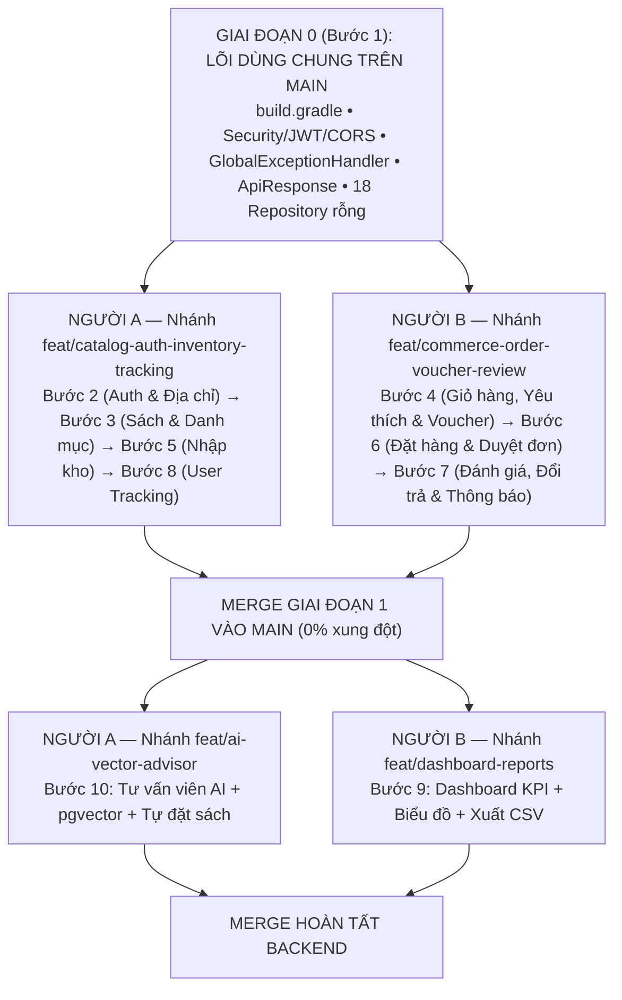

# LỘ TRÌNH TRIỂN KHAI BACKEND & PHÂN CÔNG 2 NGƯỜI (KHÔNG XUNG ĐỘT GIT)

**Dự án:** Hệ sinh thái Thương mại Điện tử Nhà sách Tri Thức Việt (`BookStore_Antigravity`)  
**Đối tượng đọc:** Thành viên mới tham gia code Backend Spring Boot + Gradle (`backend/`)

---

## 1. Dự án hiện tại đã làm xong những gì?

Trước khi bắt đầu viết code, bạn cần biết **3 phần nền đã hoàn thiện sẵn**:

1. **Cơ sở dữ liệu PostgreSQL 16 + `pgvector` (`database/`) — Đã xong 100%**:
   - Container Docker `bookstore-postgres` chạy ở `localhost:5432`, database `bookstore_db` (`postgres` / `123456`).
   - File [database/01_schema.sql](database/01_schema.sql) tạo **18 bảng tiếng Việt không dấu** (có cột `sach.vector_ngu_nghia vector(768)` và bảng `hanh_vi_nguoi_dung` cho User Tracking; bảng `cau_hinh_cua_hang` tạm ẩn).
   - File [database/02_seed_data.sql](database/02_seed_data.sql) nạp sẵn **186 cuốn sách** (12 danh mục, ảnh bìa khớp từng đầu sách), 148 tác giả, 19 tài khoản (3 `ADMIN`, 3 `WAREHOUSE_MANAGER`, 3 `CSKH`, 10 `CUSTOMER`), đơn hàng, voucher, phiếu nhập kho và hành vi mẫu.
2. **Giao diện Mobile App & Web Admin (`frontend/`) — Đã có sẵn đầy đủ màn hình**:
   - Mobile App (`frontend/client-mobile/`): Expo React Native (Trang chủ có kệ Đề xuất User Tracking, Danh mục, Chi tiết sách, Giỏ hàng, Thanh toán, Đơn hàng, Hồ sơ, Hộp thoại Tư vấn).
   - Web Admin (`frontend/admin-web/`): React + Vite (Trang Đăng nhập nội bộ chặn `CUSTOMER`, nút Đăng xuất, phân quyền 3 vai trò nhân sự trên 8 trang quản trị).
3. **Backend Spring Boot + Gradle (`backend/`) — Đã xong khung Gradle + tầng `entity/`**:
   - Java 21, Spring Boot + Gradle Wrapper (`gradlew.bat`), cấu hình `spring.jpa.hibernate.ddl-auto=validate` trong `backend/src/main/resources/application.properties`.
   - Đã hoàn thành **8 Enum** trong `entity/enums/` và **18 class `@Entity`** trong `entity/` khớp 100% với PostgreSQL (`.\gradlew.bat test` đã pass).

> **Tài liệu nên đọc thêm khi code:**
> - [CAU_TRUC_DU_AN.md](CAU_TRUC_DU_AN.md) — Bản đồ toàn dự án
> - [PHAN_TICH_NGHIEP_VU_VA_CSDL.md](PHAN_TICH_NGHIEP_VU_VA_CSDL.md) — 7 phân hệ nghiệp vụ & công thức tính toán
> - [PHAN_QUYEN_WEB_ADMIN.md](PHAN_QUYEN_WEB_ADMIN.md) — Ma trận phân quyền `ADMIN`, `WAREHOUSE_MANAGER`, `CSKH`
> - [cau_truc_backend_gradle.md](cau_truc_backend_gradle.md) & [giai_thich_cau_truc_backend.md](giai_thich_cau_truc_backend.md) — Giải thích chi tiết từng file Backend
> - [DANH_SACH_CHUC_NANG_BACKEND_CHI_TIET.md](DANH_SACH_CHUC_NANG_BACKEND_CHI_TIET.md) — Bảng ánh xạ từng nút bấm giao diện vào đúng file Backend

---

## 2. Sơ đồ Quy trình 2 Người làm Song song (0% Xung đột Git)

Nguyên tắc vàng để 2 người code cùng 1 repo mà lúc `git merge` không bị xung đột (conflict):
- **Giai đoạn 0** làm chung các file lõi trên `main` trước.
- **Giai đoạn 1 & Giai đoạn 2** chia đứt theo từng cụm file độc lập — **Người A không sửa file của Người B và ngược lại**.



---

## 3. Lộ trình 10 Bước Chi tiết (Làm cái gì trước, cái gì sau?)

| Thứ tự | Nhóm chức năng | Các tính năng cần làm | Tại sao phải làm ở thứ tự này? | Người phụ trách |
| :-: | :--- | :--- | :--- | :--- |
| **Bước 1** | **Nền móng Lõi (Foundation)** | • Thêm thư viện JWT (`jjwt`) vào `build.gradle`<br>• `exception/`: `BusinessException`, `GlobalExceptionHandler`<br>• `dto/response/ApiResponse.java`<br>• `config/`: `CorsConfig`, `JwtTokenProvider`, `JwtAuthenticationFilter`, `SecurityConfig`<br>• Tạo sẵn **18 file `Repository` rỗng** kế thừa `JpaRepository` | Phải chốt các file dùng chung trên `main` trước để cả 2 người có khuôn JSON, có bảo mật JWT và có sẵn `findById()`/`save()` trên mọi bảng mà không cần sửa file của nhau. | **Làm chung trên `main`** |
| **Bước 2** | **Tài khoản, Đăng nhập & Địa chỉ** | • Đăng ký, Đăng nhập (Mobile + Web Admin chặn `CUSTOMER`)<br>• Xem/sửa hồ sơ cá nhân<br>• Sổ địa chỉ (`@Transactional` chỉ giữ 1 `macDinh = true`)<br>• Admin khóa/mở tài khoản khách & tạo nhân sự (`ADMIN`, `WAREHOUSE_MANAGER`, `CSKH`) | Phải có JWT Token (`userId`, `vai_tro`) trước thì mới gọi và test được Giỏ hàng, Đặt hàng và phân quyền Web Admin. | **Người A** |
| **Bước 3** | **Sách, Danh mục, Tác giả & NXB** | • Cây danh mục Cha–Con<br>• Kệ Flash Sale & Sách bán chạy (Trang chủ)<br>• Tìm kiếm & lọc đa tiêu chí (giá, danh mục, sao, sắp xếp)<br>• Chi tiết sách & sách cùng chủ đề<br>• Admin/Kho CRUD Sách, Danh mục, Tác giả, NXB (chặn xóa sách đã có trong đơn) | Phải có API đọc 186 cuốn sách trước để Mobile hiển thị và lấy `sach_id` cho Giỏ hàng, Nhập kho, Đặt hàng. | **Người A** |
| **Bước 4** | **Giỏ hàng, Yêu thích & Voucher** | • Thêm/sửa/xóa/tick chọn `gio_hang` (chặn `soLuong > tonKho`)<br>• Thả tim / bỏ tim `sach_yeu_thich`<br>• Kiểm tra & tính giảm giá `ma_giam_gia` (`CO_DINH` / `PHAN_TRAM`)<br>• Admin CRUD & bật/tắt Voucher | Làm song song Bước 3. Phải xong Giỏ hàng + Voucher trước thì bước Đặt hàng mới tính được `tam_tinh` và `tien_giam_gia`. | **Người B** |
| **Bước 5** | **Quản lý Kho & Phiếu nhập kho** | • Lọc sách sắp hết hàng (`ton_kho <= 5`)<br>• Xem lịch sử phiếu nhập kho<br>• Lập phiếu nhập kho (`@Transactional`: lưu `PhieuNhapKho` + `ChiTietPhieuNhap` + cộng dồn `sach.ton_kho`) | Làm ngay sau Bước 3 (đã có `SachRepository`) và song song với Bước 6 của Người B. | **Người A** |
| **Bước 6** | **Đặt hàng, Timeline & Hủy đơn** | • Đặt hàng `@Transactional`: kiểm tra kho → trừ `ton_kho`, tăng `da_ban` → tăng `da_su_dung` voucher → lưu `DonHang` + `ChiTietDonHang` + `LichSuDonHang` → xóa giỏ → tạo `ThongBao`<br>• Khách xem đơn & Hủy đơn `CHO_XAC_NHAN` (hoàn kho)<br>• Admin/Kho/CSKH chuyển trạng thái đơn 1 chiều | **Trái tim nghiệp vụ.** Phụ thuộc vào Địa chỉ (Bước 2), Sách (Bước 3), Giỏ hàng & Voucher (Bước 4). | **Người B** |
| **Bước 7** | **Hậu mãi: Đánh giá, Đổi trả & Thông báo** | • Khách gửi đánh giá 1–5 sao (chỉ khi đơn `DA_GIAO`, tự tính lại `diem_danh_gia_tb`)<br>• CSKH/Admin ẩn bình luận vi phạm<br>• Khách gửi yêu cầu đổi trả (`CHO_DUYET`) & CSKH/Admin duyệt/từ chối<br>• Xem & đánh dấu đã đọc `thong_bao` | Phải làm sau Bước 6 vì nút Đánh giá và Đổi trả chỉ mở khóa khi đơn hàng đã chuyển sang `DA_GIAO`. | **Người B** |
| **Bước 8** | **User Tracking & Đề xuất sách** | • `POST /api/v1/tracking/event`: ghi nhận `thoi_gian_xem_giay` (Dwell time) và hành vi (`XEM_CHI_TIET`, `THEM_YEU_THICH`, `THEM_GIO_HANG`, `MUA_HANG`, `BO_QUA_DE_XUAT`)<br>• `GET /api/v1/books/recommendations`: tính Time Decay + Impression Fatigue + loại trừ sách đã lưu/mua + pha trộn đa chủ đề 3:2:1 | Cần có Sách, Yêu thích, Giỏ hàng, Đơn hàng để biết danh sách sách khách đã lưu/mua mà loại trừ khỏi kệ Đề xuất. | **Người A** |
| **Bước 9** | **Dashboard KPI, Biểu đồ & Xuất CSV** | • 4 thẻ KPI (Doanh thu, Lợi nhuận, Tổng đơn, Khách mới)<br>• Biểu đồ theo Ngày / Tháng / Năm<br>• Top sách bán chạy & Xuất 3 file Excel CSV có UTF-8 BOM | Tổng hợp số liệu từ `DonHang` (Người B), `PhieuNhapKho` & `Sach` (Người A) nên làm ngay sau khi merge Giai đoạn 1. | **Người B** *(Giai đoạn 2)* |
| **Bước 10** | **Tư vấn viên AI + `pgvector` + Tự đặt sách** | • `BookVectorService`: đồng bộ 186 sách sang `sach.vector_ngu_nghia` (`vector(768)`)<br>• `BookstoreAiTools`: gọi tìm sách ngữ nghĩa, xem voucher, lấy địa chỉ mặc định, tự thêm giỏ & tự tạo đơn<br>• `AdvisorChatService` & `ClientChatController` | **Luôn làm sau cùng**, vì AI Tools sẽ gọi lại trực tiếp các Service đã chạy ổn định (`BookService`, `VoucherService`, `CartWishlistService`, `OrderService`). | **Người A** *(Giai đoạn 2)* |

---

## 4. Bảng Sở hữu File Độc quyền (Chống xung đột ở Giai đoạn 1)

### 👤 NGƯỜI A (`feat/catalog-auth-inventory-tracking`)
- **Repository được thêm hàm**: `TkNguoiDungRepository`, `SoDiaChiRepository`, `SachRepository`, `DanhMucRepository`, `TacGiaRepository`, `NhaXuatBanRepository`, `PhieuNhapKhoRepository`, `ChiTietPhieuNhapRepository`, `HanhViNguoiDungRepository`
- **Service**: `AuthService`, `UserAddressService`, `BookService`, `InventoryService`, `RecommendationTrackingService`
- **Controller**: `ClientAuthController`, `ClientAddressController`, `ClientBookController`, `ClientTrackingController`, `AdminUserController`, `AdminBookCategoryController`, `AdminInventoryController`
- **DTO**: `LoginRequest`, `RegisterRequest`, `UpdateProfileRequest`, `AddressUpsertRequest`, `CreateStaffRequest`, `BookFilterRequest`, `BookUpsertRequest`, `CategoryUpsertRequest`, `CreateInventoryReceiptRequest`, `TrackBehaviorRequest`, `AuthResponse`, `UserDto`, `AddressDto`, `BookDto`, `BookDetailDto`, `CategoryDto`, `InventoryReceiptDto`, `RecommendationResponse`

### 👤 NGƯỜI B (`feat/commerce-order-voucher-review`)
- **Repository được thêm hàm**: `GioHangRepository`, `SachYeuThichRepository`, `MaGiamGiaRepository`, `DonHangRepository`, `ChiTietDonHangRepository`, `LichSuDonHangRepository`, `DanhGiaRepository`, `YeuCauDoiTraRepository`, `ThongBaoRepository`
- **Service**: `CartWishlistService`, `VoucherService`, `OrderService`, `ReviewReturnService`, `NotificationService`
- **Controller**: `ClientCartController`, `ClientWishlistController`, `ClientVoucherController`, `ClientOrderController`, `ClientReviewReturnController`, `ClientNotificationController`, `AdminVoucherController`, `AdminOrderReturnController`, `AdminReviewNotifController`
- **DTO**: `CartItemRequest`, `ApplyVoucherRequest`, `VoucherUpsertRequest`, `CreateOrderRequest`, `CancelOrderRequest`, `UpdateOrderStatusRequest`, `CreateReviewRequest`, `CreateReturnRequest`, `ProcessReturnRequest`, `CreateNotificationRequest`, `CartResponseDto`, `VoucherDto`, `VoucherValidationResponse`, `OrderDto`, `ReviewDto`, `ReturnRequestDto`, `NotificationDto`

---

## 5. Quy tắc Git & Kiểm tra trước khi Merge

1. **Không tự sửa file chung trong nhánh riêng**: Không chỉnh `build.gradle`, `application.properties`, `SecurityConfig.java` hay file `Repository` của người kia khi đang làm Giai đoạn 1.
2. **Luôn giữ `ddl-auto=validate`**: Tuyệt đối không đổi sang `create` hoặc `create-drop` để tránh xóa mất 186 cuốn sách và dữ liệu mẫu trong `bookstore_db`.
3. **Bật Docker & chạy test trước khi `git push`**:
   ```powershell
   # 1. Đảm bảo PostgreSQL trong Docker đang chạy
   docker start bookstore-postgres

   # 2. Chạy kiểm thử toàn bộ Backend
   cd backend
   .\gradlew.bat test
   ```
   Chỉ mở Pull Request / Merge vào `main` khi kết quả báo **`BUILD SUCCESSFUL`**.
