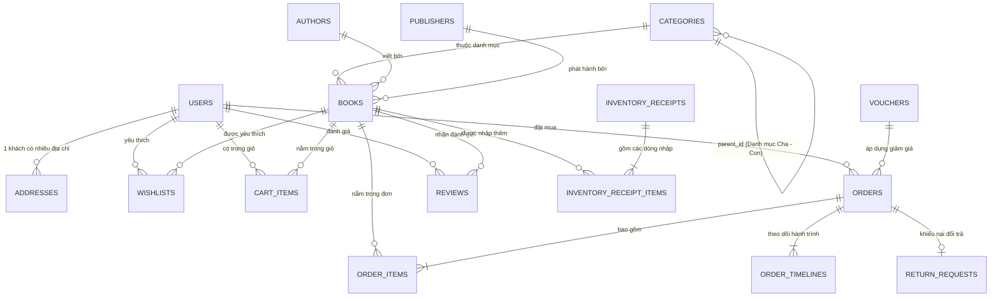

# TÀI LIỆU PHÂN TÍCH NGHIỆP VỤ & THIẾT KẾ CƠ SỞ DỮ LIỆU
**Dự án:** Hệ sinh thái Thương mại điện tử Nhà sách Tri Thức Việt (BookStore)  
**Phạm vi:** Ứng dụng Di động Khách hàng (Mobile App) & Hệ thống Quản trị (Web Admin Dashboard)

---

## MỤC LỤC NHANH
1. [Tổng quan Danh sách 14 Bảng CSDL](#1-tổng-quan-danh-sách-14-bảng-csdl)
2. [Sơ đồ Quan hệ Thực thể (ERD)](#2-sơ-đồ-quan-hệ-thực-thể-erd)
3. [Chi tiết Cấu trúc Bảng & Quy tắc Nghiệp vụ từng Phân hệ](#3-chi-tiết-cấu-trúc-bảng--quy-tắc-nghiệp-vụ-từng-phân-hệ)
   - [Phân hệ 1: Tài khoản, Phân quyền & Sổ địa chỉ](#phân-hệ-1-tài-khoản-phân-quyền--sổ-địa-chỉ)
   - [Phân hệ 2: Danh mục, Tác giả, NXB & Kho Sách](#phân-hệ-2-danh-mục-tác-giả-nxb--kho-sách)
   - [Phân hệ 3: Quản lý Nhập Kho & Tồn Kho](#phân-hệ-3-quản-lý-nhập-kho--tồn-kho)
   - [Phân hệ 4: Giỏ hàng, Mã giảm giá (Voucher) & Đặt hàng](#phân-hệ-4-giỏ-hàng-mã-giảm-giá-voucher--đặt-hàng)
   - [Phân hệ 5: Hậu mãi — Đánh giá Sách & Đổi trả hàng](#phân-hệ-5-hậu-mãi--đánh-giá-sách--đổi-trả-hàng)
   - [Phân hệ 6: Thông báo, Tư vấn & Cấu hình Cửa hàng](#phân-hệ-6-thông-báo-tư-vấn--cấu-hình-cửa-hàng)
4. [Bảng Tổng hợp Công thức Tính toán trong Hệ thống](#4-bảng-tổng-hợp-công-thức-tính-toán-trong-hệ-thống)

---

## 1. Tổng quan Danh sách 14 Bảng CSDL

| STT | Tên Bảng (Table) | Tên Tiếng Việt | Phân hệ sử dụng | Quan hệ chính (Khóa ngoại) |
| :-: | :--- | :--- | :--- | :--- |
| 1 | `users` | Người dùng & Nhân sự | Mobile & Web Admin | Bảng gốc |
| 2 | `addresses` | Sổ địa chỉ nhận hàng | Mobile (Hồ sơ & Checkout) | `user_id` $\rightarrow$ `users.id` |
| 3 | `categories` | Danh mục sách (Cha/Con) | Mobile & Web Admin | `parent_id` $\rightarrow$ `categories.id` |
| 4 | `authors` | Tác giả | Mobile & Web Admin | Bảng gốc |
| 5 | `publishers` | Nhà xuất bản | Mobile & Web Admin | Bảng gốc |
| 6 | `books` | Thông tin Sách | Mobile & Web Admin | `category_id`, `author_id`, `publisher_id` |
| 7 | `wishlists` | Sách yêu thích | Mobile (Tài khoản) | `user_id` $\rightarrow$ `users.id`, `book_id` $\rightarrow$ `books.id` |
| 8 | `inventory_receipts` | Phiếu nhập kho | Web Admin (Quản lý Kho) | `created_by` $\rightarrow$ `users.id` |
| 9 | `inventory_receipt_items` | Chi tiết phiếu nhập kho | Web Admin (Quản lý Kho) | `receipt_id`, `book_id` |
| 10 | `cart_items` | Giỏ hàng | Mobile (Giỏ hàng) | `user_id` $\rightarrow$ `users.id`, `book_id` $\rightarrow$ `books.id` |
| 11 | `vouchers` | Mã giảm giá | Mobile & Web Admin | Bảng gốc |
| 12 | `orders` | Đơn đặt hàng | Mobile & Web Admin | `user_id` $\rightarrow$ `users.id`, `voucher_code` |
| 13 | `order_items` | Chi tiết sách trong đơn | Mobile & Web Admin | `order_id` $\rightarrow$ `orders.id`, `book_id` $\rightarrow$ `books.id` |
| 14 | `order_timelines` | Lịch sử vận chuyển | Mobile & Web Admin | `order_id` $\rightarrow$ `orders.id` |
| 15 | `return_requests` | Yêu cầu đổi trả hàng | Mobile & Web Admin | `order_id` $\rightarrow$ `orders.id` (Quan hệ 1-1) |
| 16 | `reviews` | Đánh giá & Nhận xét sách | Mobile & Web Admin | `book_id`, `user_id`, `order_id` |
| 17 | `notifications` | Thông báo đẩy | Mobile & Web Admin | `user_id` $\rightarrow$ `users.id` (Nullable) |
| 18 | `store_configs` | Cấu hình cửa hàng | Web Admin (Cấu hình) | Bảng 1 dòng duy nhất (Singleton) |

---

## 2. Sơ đồ Quan hệ Thực thể (ERD)



---

## 3. Chi tiết Cấu trúc Bảng & Quy tắc Nghiệp vụ từng Phân hệ

---

### PHÂN HỆ 1: Tài khoản, Phân quyền & Sổ địa chỉ

#### A. Thiết kế Bảng

**1. Bảng `users` (Người dùng & Nhân viên)**
| Tên cột | Kiểu dữ liệu gợi ý | Ràng buộc | Ý nghĩa |
| :--- | :--- | :--- | :--- |
| `id` | `VARCHAR(50)` / `UUID` | `PRIMARY KEY` | Mã định danh người dùng |
| `full_name` | `NVARCHAR(100)` | `NOT NULL` | Họ và tên |
| `email` | `VARCHAR(120)` | `UNIQUE, NOT NULL` | Email đăng nhập |
| `password_hash` | `VARCHAR(255)` | `NOT NULL` | Mật khẩu đã mã hóa |
| `phone` | `VARCHAR(20)` | `NOT NULL` | Số điện thoại |
| `role` | `VARCHAR(30)` | `DEFAULT 'CUSTOMER'` | Giá trị: `'CUSTOMER'`, `'ADMIN'`, `'WAREHOUSE_MANAGER'`, `'CSKH'` |
| `is_locked` | `BOOLEAN` / `BIT` | `DEFAULT 0` | `1`: Tài khoản bị khóa, `0`: Hoạt động |
| `total_spent` | `DECIMAL(15,0)` | `DEFAULT 0` | Tổng tiền đã mua tích lũy (VND) |
| `order_count` | `INT` | `DEFAULT 0` | Tổng số đơn hàng đã mua |
| `created_at` | `DATETIME` | `DEFAULT NOW()` | Ngày tạo tài khoản |

**2. Bảng `addresses` (Sổ địa chỉ nhận hàng)**
| Tên cột | Kiểu dữ liệu gợi ý | Ràng buộc | Ý nghĩa |
| :--- | :--- | :--- | :--- |
| `id` | `VARCHAR(50)` | `PRIMARY KEY` | Mã địa chỉ |
| `user_id` | `VARCHAR(50)` | `FOREIGN KEY (users.id)` | Chủ sở hữu địa chỉ |
| `full_name` | `NVARCHAR(100)` | `NOT NULL` | Họ tên người nhận hàng |
| `phone` | `VARCHAR(20)` | `NOT NULL` | SĐT người nhận hàng |
| `province` | `NVARCHAR(100)` | `NOT NULL` | Tỉnh / Thành phố |
| `district` | `NVARCHAR(100)` | `NOT NULL` | Quận / Huyện |
| `ward` | `NVARCHAR(100)` | `NOT NULL` | Phường / Xã |
| `street_address`| `NVARCHAR(255)` | `NOT NULL` | Số nhà, tên đường, tòa nhà |
| `is_default` | `BOOLEAN` / `BIT` | `DEFAULT 0` | `1`: Địa chỉ mặc định khi thanh toán |

#### B. Quy tắc Nghiệp vụ (Business Rules)
- **Quy tắc 1.1 — Chặn đăng nhập chéo nền tảng (Platform Guard):**
  - App Mobile chỉ cho phép `role = 'CUSTOMER'` đăng nhập. Nếu nhập tài khoản có `role` là `'ADMIN'`, `'WAREHOUSE_MANAGER'` hoặc `'CSKH'`, hệ thống chặn và báo lỗi: *"Tài khoản quản trị viên vui lòng đăng nhập trên hệ thống Web Dashboard máy tính"*.
  - Web Admin chỉ cho phép `role != 'CUSTOMER'` đăng nhập.
- **Quy tắc 1.2 — Kiểm tra khóa tài khoản:**
  - Nếu `is_locked = true`, từ chối đăng nhập ngay lập tức.
- **Quy tắc 1.3 — Địa chỉ mặc định duy nhất:**
  - Mỗi `user_id` chỉ có **tối đa 1 dòng** `is_default = true`. Khi khách hàng đặt 1 địa chỉ làm mặc định, tất cả địa chỉ khác của `user_id` đó phải chuyển về `is_default = false`.

---

### PHÂN HỆ 2: Danh mục, Tác giả, NXB & Kho Sách

#### A. Thiết kế Bảng

**1. Bảng `categories` (Danh mục phân cấp Cha - Con)**
| Tên cột | Kiểu dữ liệu gợi ý | Ràng buộc | Ý nghĩa |
| :--- | :--- | :--- | :--- |
| `id` | `VARCHAR(50)` | `PRIMARY KEY` | Mã danh mục |
| `name` | `NVARCHAR(120)` | `NOT NULL` | Tên danh mục |
| `slug` | `VARCHAR(150)` | `UNIQUE` | Đường dẫn thân thiện |
| `parent_id` | `VARCHAR(50)` | `FK (categories.id), NULL`| `NULL` = Danh mục Cha; Có giá trị = Danh mục Con |
| `description` | `NVARCHAR(500)` | `NULL` | Mô tả chuyên mục |
| `display_order` | `INT` | `DEFAULT 1` | Thứ tự sắp xếp |
| `is_active` | `BOOLEAN` / `BIT` | `DEFAULT 1` | Trạng thái hoạt động |

**2. Bảng `authors` (Tác giả) & `publishers` (Nhà xuất bản)**
- `authors`: `id` (PK), `name` (`NVARCHAR(120)`), `bio` (`NVARCHAR(500)`).
- `publishers`: `id` (PK), `name` (`NVARCHAR(150)`), `address` (`NVARCHAR(255)`).

**3. Bảng `books` (Sách)**
| Tên cột | Kiểu dữ liệu gợi ý | Ràng buộc | Ý nghĩa |
| :--- | :--- | :--- | :--- |
| `id` | `VARCHAR(50)` | `PRIMARY KEY` | Mã sách |
| `isbn` | `VARCHAR(30)` | `UNIQUE, NOT NULL` | Mã ISBN quốc tế (VD: `978-604-1-20451-1`) |
| `title` | `NVARCHAR(255)` | `NOT NULL` | Tên cuốn sách |
| `category_id` | `VARCHAR(50)` | `FK (categories.id)` | Thuộc danh mục |
| `author_id` | `VARCHAR(50)` | `FK (authors.id)` | Tác giả |
| `publisher_id` | `VARCHAR(50)` | `FK (publishers.id)` | Nhà xuất bản |
| `price` | `DECIMAL(12,0)` | `NOT NULL` | Giá bán thường (VND) |
| `original_price`| `DECIMAL(12,0)` | `NOT NULL` | Giá bìa / Giá gốc trước khi giảm |
| `is_flash_sale` | `BOOLEAN` / `BIT` | `DEFAULT 0` | Đang trong chương trình Flash Sale |
| `flash_sale_price`| `DECIMAL(12,0)` | `NULL` | Giá bán Flash Sale (nếu có) |
| `stock` | `INT` | `DEFAULT 0, CHECK >= 0` | Số lượng tồn kho thực tế |
| `sold_count` | `INT` | `DEFAULT 0` | Tổng số lượng đã bán |
| `rating_avg` | `DECIMAL(3,2)` | `DEFAULT 5.0` | Điểm đánh giá sao trung bình (`1.0` - `5.0`) |
| `rating_count` | `INT` | `DEFAULT 0` | Số lượt đánh giá |
| `page_count` | `INT` | `NULL` | Số trang |
| `publish_year` | `INT` | `NULL` | Năm xuất bản |
| `cover_format` | `NVARCHAR(30)` | `DEFAULT N'Bìa mềm'` | `'Bìa mềm'` hoặc `'Bìa cứng'` |
| `cover_url` | `VARCHAR(500)` | `NOT NULL` | Link ảnh bìa sách |
| `short_summary` | `NVARCHAR(500)` | `NULL` | Tóm tắt ngắn |
| `description` | `NVARCHAR(MAX)` | `NULL` | Nội dung giới thiệu chi tiết |
| `is_best_seller`| `BOOLEAN` / `BIT` | `DEFAULT 0` | Sách bán chạy nổi bật |
| `is_visible` | `BOOLEAN` / `BIT` | `DEFAULT 1` | `1`: Hiển thị trên App Mobile, `0`: Ẩn |
| `created_at` | `DATETIME` | `DEFAULT NOW()` | Ngày thêm sách |

#### B. Quy tắc Nghiệp vụ (Business Rules)
- **Quy tắc 2.1 — Ẩn/Hiện sách (`is_visible`):**
  - Không xóa cứng (`DELETE`) các cuốn sách đã từng nằm trong đơn hàng cũ để tránh lỗi khóa ngoại lịch sử đơn. Khi ngừng kinh doanh, Admin chuyển `is_visible = false` để ẩn khỏi Mobile App.
- **Quy tắc 2.2 — Giá bán áp dụng:**
  - Nếu `is_flash_sale = true` và `flash_sale_price > 0`, hệ thống lấy `flash_sale_price` làm đơn giá tính tiền. Ngược lại lấy `price`.

---

### PHÂN HỆ 3: Quản lý Nhập Kho & Tồn Kho

#### A. Thiết kế Bảng

**1. Bảng `inventory_receipts` (Phiếu nhập kho)**
| Tên cột | Kiểu dữ liệu gợi ý | Ràng buộc | Ý nghĩa |
| :--- | :--- | :--- | :--- |
| `id` | `VARCHAR(50)` | `PRIMARY KEY` | Mã định danh phiếu |
| `receipt_code` | `VARCHAR(30)` | `UNIQUE, NOT NULL` | Mã phiếu (VD: `PNK-202611-01`) |
| `supplier_name` | `NVARCHAR(200)` | `NOT NULL` | Tên nhà cung cấp / Nhà phát hành |
| `created_by` | `NVARCHAR(100)` | `NOT NULL` | Nhân viên lập phiếu |
| `note` | `NVARCHAR(500)` | `NULL` | Ghi chú chứng từ |
| `total_quantity`| `INT` | `NOT NULL` | Tổng số lượng sách nhập |
| `total_cost` | `DECIMAL(15,0)` | `NOT NULL` | Tổng tiền nhập kho (VND) |
| `created_at` | `DATETIME` | `DEFAULT NOW()` | Ngày lập phiếu |

**2. Bảng `inventory_receipt_items` (Chi tiết từng sách trong phiếu nhập)**
| Tên cột | Kiểu dữ liệu gợi ý | Ràng buộc | Ý nghĩa |
| :--- | :--- | :--- | :--- |
| `id` | `VARCHAR(50)` | `PRIMARY KEY` | Mã dòng chi tiết |
| `receipt_id` | `VARCHAR(50)` | `FK (inventory_receipts.id)` | Thuộc phiếu nhập nào |
| `book_id` | `VARCHAR(50)` | `FK (books.id)` | Đầu sách nhập |
| `quantity` | `INT` | `CHECK (quantity > 0)` | Số lượng nhập thêm |
| `import_price` | `DECIMAL(12,0)` | `CHECK (import_price >= 0)` | Giá vốn nhập 1 cuốn |

#### B. Quy tắc Nghiệp vụ (Business Rules)
- **Quy tắc 3.1 — Cảnh báo sách sắp hết hàng tự động:**
  - Hệ thống kiểm tra điều kiện `books.stock < 5` (ngưỡng cấu hình tại `store_configs.low_stock_threshold`). Nếu nhỏ hơn 5 cuốn, tự động bật cảnh báo đỏ trên Sidebar, Chuông thông báo và trang Quản lý Kho của Admin.
- **Quy tắc 3.2 — Tự động cộng tồn kho khi lập phiếu nhập:**
  - Ngay khi tạo phiếu nhập thành công, hệ thống tự động cập nhật:
    $$\text{books.stock}_{\text{mới}} = \text{books.stock}_{\text{cũ}} + \text{quantity}$$

---

### PHÂN HỆ 4: Giỏ hàng, Mã giảm giá (Voucher) & Đặt hàng

#### A. Thiết kế Bảng

**1. Bảng `vouchers` (Mã giảm giá)**
| Tên cột | Kiểu dữ liệu gợi ý | Ràng buộc | Ý nghĩa |
| :--- | :--- | :--- | :--- |
| `id` | `VARCHAR(50)` | `PRIMARY KEY` | Mã định danh voucher |
| `code` | `VARCHAR(30)` | `UNIQUE, NOT NULL` | Mã nhập (VD: `CHAOHE50K`, `FREESHIP25K`) |
| `title` | `NVARCHAR(150)` | `NOT NULL` | Tên chương trình ưu đãi |
| `discount_type` | `VARCHAR(20)` | `NOT NULL` | `'FIXED'` (Giảm tiền mặt) hoặc `'PERCENTAGE'` (Giảm %) |
| `discount_value`| `DECIMAL(12,0)` | `NOT NULL` | Số tiền giảm hoặc số % giảm |
| `max_discount_amount` | `DECIMAL(12,0)` | `NULL` | Mức giảm tối đa khi giảm theo % |
| `min_order_value` | `DECIMAL(12,0)` | `DEFAULT 0` | Đơn tối thiểu để áp dụng mã |
| `usage_limit` | `INT` | `NOT NULL` | Tổng số lượt phát hành |
| `used_count` | `INT` | `DEFAULT 0` | Số lượt đã sử dụng |
| `start_date` | `DATE` | `NOT NULL` | Ngày bắt đầu |
| `end_date` | `DATE` | `NOT NULL` | Ngày kết thúc |
| `is_active` | `BOOLEAN` / `BIT` | `DEFAULT 1` | Đang kích hoạt hay tạm ngưng |

**2. Bảng `orders` (Đơn hàng)**
| Tên cột | Kiểu dữ liệu gợi ý | Ràng buộc | Ý nghĩa |
| :--- | :--- | :--- | :--- |
| `id` | `VARCHAR(50)` | `PRIMARY KEY` | Mã định danh đơn |
| `order_code` | `VARCHAR(30)` | `UNIQUE, NOT NULL` | Mã đơn hiển thị (VD: `BS-261101`) |
| `user_id` | `VARCHAR(50)` | `FK (users.id)` | Khách hàng đặt mua |
| `customer_name` | `NVARCHAR(100)` | `NOT NULL` | Tên người nhận lúc đặt |
| `customer_phone`| `VARCHAR(20)` | `NOT NULL` | SĐT người nhận lúc đặt |
| `shipping_address_text` | `NVARCHAR(500)` | `NOT NULL` | Địa chỉ giao đầy đủ lúc đặt |
| `subtotal` | `DECIMAL(15,0)` | `NOT NULL` | Tổng tiền hàng tạm tính |
| `shipping_fee` | `DECIMAL(12,0)` | `NOT NULL` | Phí vận chuyển (`0` hoặc `25000`) |
| `discount_amount`| `DECIMAL(12,0)` | `DEFAULT 0` | Số tiền được giảm qua Voucher |
| `voucher_code` | `VARCHAR(30)` | `NULL` | Mã voucher đã áp dụng |
| `total_amount` | `DECIMAL(15,0)` | `NOT NULL` | Tổng tiền thanh toán cuối cùng |
| `payment_method`| `VARCHAR(20)` | `NOT NULL` | `'COD'`, `'BANK_QR'`, `'EWALLET'` |
| `payment_status`| `VARCHAR(20)` | `DEFAULT 'UNPAID'` | `'UNPAID'`, `'PAID'`, `'REFUNDED'` |
| `status` | `VARCHAR(20)` | `DEFAULT 'PENDING'` | `'PENDING'`, `'PREPARING'`, `'SHIPPING'`, `'DELIVERED'`, `'CANCELLED'` |
| `note` | `NVARCHAR(500)` | `NULL` | Ghi chú giao hàng của khách |
| `is_reviewed` | `BOOLEAN` / `BIT` | `DEFAULT 0` | Đã đánh giá sao hay chưa |
| `created_at` | `DATETIME` | `DEFAULT NOW()` | Thời điểm đặt hàng |

**3. Bảng `order_items` (Chi tiết đơn hàng) & `order_timelines` (Hành trình đơn)**
- `order_items`: `id` (PK), `order_id` (FK), `book_id` (FK), `title`, `cover_url`, `author_name`, `unit_price`, `quantity`.
- `order_timelines`: `id` (PK), `order_id` (FK), `status`, `title`, `description`, `timestamp`.

#### B. Quy tắc Nghiệp vụ (Business Rules)
- **Quy tắc 4.1 — Vòng đời trạng thái đơn hàng (Order Lifecycle):**
  ```mermaid
  stateDiagram-v2
      [*] --> PENDING : Khách đặt hàng
      PENDING --> PREPARING : Admin duyệt đơn & đóng gói
      PENDING --> CANCELLED : Khách hủy đơn (Chỉ cho phép ở bước này)
      PREPARING --> SHIPPING : Bàn giao bưu tá vận chuyển
      SHIPPING --> DELIVERED : Giao thành công (Payment -> PAID)
  ```
- **Quy tắc 4.2 — Quy tắc Hủy đơn:**
  - Khách hàng chỉ được phép bấm **Hủy đơn** khi `status = 'PENDING'`. Khi Admin đã chuyển sang `'PREPARING'` hoặc `'SHIPPING'`, không được phép hủy.
- **Quy tắc 4.3 — Trừ tồn kho khi đặt hàng:**
  - Khi đơn hàng được tạo, tự động giảm `books.stock` đi `quantity` và tăng `books.sold_count` thêm `quantity`.

---

### PHÂN HỆ 5: Hậu mãi — Đánh giá Sách & Đổi trả hàng

#### A. Thiết kế Bảng

**1. Bảng `reviews` (Đánh giá sản phẩm)**
| Tên cột | Kiểu dữ liệu gợi ý | Ràng buộc | Ý nghĩa |
| :--- | :--- | :--- | :--- |
| `id` | `VARCHAR(50)` | `PRIMARY KEY` | Mã đánh giá |
| `book_id` | `VARCHAR(50)` | `FK (books.id)` | Cuốn sách được đánh giá |
| `user_id` | `VARCHAR(50)` | `FK (users.id)` | Khách hàng đánh giá |
| `order_id` | `VARCHAR(50)` | `FK (orders.id)` | Đánh giá từ đơn hàng nào |
| `rating` | `INT` | `CHECK (rating BETWEEN 1 AND 5)` | Điểm sao (`1` đến `5`) |
| `comment` | `NVARCHAR(1000)` | `NOT NULL` | Nội dung nhận xét |
| `image_urls` | `NVARCHAR(MAX)` | `NULL` | Chuỗi JSON lưu ảnh đính kèm |
| `is_hidden` | `BOOLEAN` / `BIT` | `DEFAULT 0` | `1`: Bị Admin ẩn do vi phạm/spam |
| `created_at` | `DATETIME` | `DEFAULT NOW()` | Thời gian gửi đánh giá |

**2. Bảng `return_requests` (Yêu cầu đổi trả hàng)**
| Tên cột | Kiểu dữ liệu gợi ý | Ràng buộc | Ý nghĩa |
| :--- | :--- | :--- | :--- |
| `id` | `VARCHAR(50)` | `PRIMARY KEY` | Mã yêu cầu đổi trả |
| `order_id` | `VARCHAR(50)` | `FK UNIQUE (orders.id)` | Đơn hàng yêu cầu đổi trả |
| `reason` | `NVARCHAR(255)` | `NOT NULL` | Lý do (Móp góc, lỗi in ấn, giao sai...) |
| `description` | `NVARCHAR(1000)` | `NOT NULL` | Mô tả chi tiết tình trạng sách |
| `evidence_images`| `NVARCHAR(MAX)` | `NOT NULL` | Ảnh chụp minh chứng lỗi sản phẩm |
| `status` | `VARCHAR(20)` | `DEFAULT 'PENDING'` | `'PENDING'`, `'APPROVED'`, `'REJECTED'` |
| `admin_note` | `NVARCHAR(500)` | `NULL` | Ghi chú xử lý của Admin |
| `created_at` | `DATETIME` | `DEFAULT NOW()` | Ngày gửi yêu cầu |
| `resolved_at` | `DATETIME` | `NULL` | Ngày Admin duyệt/từ chối |

#### B. Quy tắc Nghiệp vụ (Business Rules)
- **Quy tắc 5.1 — Điều kiện mở khóa nút Đánh giá & Đổi trả:**
  - Chỉ những đơn hàng có `status = 'DELIVERED'` (Đã giao thành công) mới hiển thị nút **Đánh giá ★** và nút **Đổi trả** trên Mobile App.
- **Quy tắc 5.2 — Kiểm duyệt bình luận:**
  - Admin có quyền chuyển `reviews.is_hidden = true` đối với các bình luận quảng cáo/spam. Mobile App chỉ hiển thị các bình luận có `is_hidden = false`.

---

### PHÂN HỆ 6: Thông báo, Tư vấn & Cấu hình Cửa hàng

1. **Bảng `notifications` (Thông báo đẩy):**
   - Các cột: `id` (PK), `user_id` (FK Nullable — nếu `NULL` là thông báo khuyến mãi gửi cho toàn bộ khách hàng), `title`, `message`, `type` (`'ORDER'` | `'PROMO'` | `'SYSTEM'`), `is_read` (`DEFAULT 0`), `created_at`.
2. **Bảng `store_configs` (Cấu hình hệ thống cửa hàng):**
   - Các cột: `id` (PK), `store_name`, `tagline`, `logo_url`, `hotline`, `support_email`, `headquarters_address`, `default_shipping_fee` (`25000`), `free_shipping_threshold` (`300000`), `low_stock_threshold` (`5`), `bank_name`, `bank_account_number`, `bank_account_holder`.

---

## 4. Bảng Tổng hợp Công thức Tính toán trong Hệ thống

| Hạng mục tính | Công thức chuẩn áp dụng trong Code & CSDL |
| :--- | :--- |
| **1. Tạm tính (`subtotal`)** | $\sum (\text{Đơn giá hiệu lực của sách được chọn} \times \text{Số lượng})$ |
| **2. Phí vận chuyển (`shipping_fee`)** | Nếu $\text{subtotal} \ge 300.000\text{ đ} \Rightarrow 0\text{ đ}$ (Freeship)<br>Nếu $\text{subtotal} < 300.000\text{ đ} \Rightarrow 25.000\text{ đ}$ |
| **3. Giảm giá Voucher (`discount_amount`)** | • Nếu loại `'FIXED'`: $\text{discount\_value}$<br>• Nếu loại `'PERCENTAGE'`: $\min\left(\frac{\text{subtotal} \times \text{discount\_value}}{100}, \text{max\_discount\_amount}\right)$ |
| **4. Tổng thanh toán (`total_amount`)** | $\max(0, \text{subtotal} + \text{shipping\_fee} - \text{discount\_amount})$ |
| **5. Cảnh báo tồn kho (`low_stock`)** | $\text{books.stock} < \text{store\_configs.low\_stock\_threshold}\ (5\text{ cuốn})$ |

