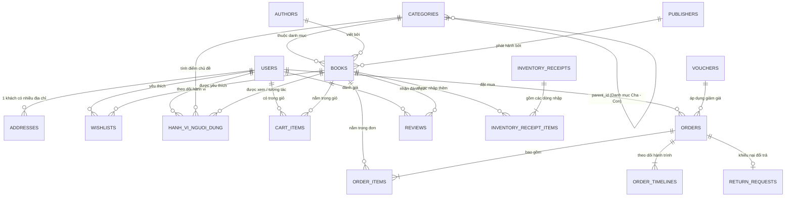

# TÀI LIỆU PHÂN TÍCH NGHIỆP VỤ & THIẾT KẾ CƠ SỞ DỮ LIỆU
**Dự án:** Hệ sinh thái Thương mại điện tử Nhà sách Tri Thức Việt (BookStore)  
**Phạm vi:** Ứng dụng Di động Khách hàng (Mobile App) & Hệ thống Quản trị (Web Admin Dashboard)

---

## MỤC LỤC NHANH
1. [Tổng quan Danh sách 18 Bảng CSDL](#1-tổng-quan-danh-sách-18-bảng-csdl)
2. [Sơ đồ Quan hệ Thực thể (ERD)](#2-sơ-đồ-quan-hệ-thực-thể-erd)
3. [Chi tiết Cấu trúc Bảng & Quy tắc Nghiệp vụ từng Phân hệ](#3-chi-tiết-cấu-trúc-bảng--quy-tắc-nghiệp-vụ-từng-phân-hệ)
   - [Phân hệ 1: Tài khoản, Phân quyền & Sổ địa chỉ](#phân-hệ-1-tài-khoản-phân-quyền--sổ-địa-chỉ)
   - [Phân hệ 2: Danh mục, Tác giả, NXB & Kho Sách](#phân-hệ-2-danh-mục-tác-giả-nxb--kho-sách)
   - [Phân hệ 3: Quản lý Nhập Kho & Tồn Kho](#phân-hệ-3-quản-lý-nhập-kho--tồn-kho)
   - [Phân hệ 4: Giỏ hàng, Mã giảm giá (Voucher) & Đặt hàng](#phân-hệ-4-giỏ-hàng-mã-giảm-giá-voucher--đặt-hàng)
   - [Phân hệ 5: Hậu mãi — Đánh giá Sách & Đổi trả hàng](#phân-hệ-5-hậu-mãi--đánh-giá-sách--đổi-trả-hàng)
   - [Phân hệ 6: Thông báo, Tư vấn AI (pgvector) & Cấu hình Cửa hàng](#phân-hệ-6-thông-báo-tư-vấn-ai-pgvector--cấu-hình-cửa-hàng)
   - [Phân hệ 7: Theo dõi Thói quen Người dùng (User Tracking) & Đề xuất Sách Cá nhân hóa](#phân-hệ-7-theo-dõi-thói-quen-người-dùng-user-tracking--đề-xuất-sách-cá-nhân-hóa)
4. [Bảng Tổng hợp Công thức Tính toán trong Hệ thống](#4-bảng-tổng-hợp-công-thức-tính-toán-trong-hệ-thống)

---

## 1. Tổng quan Danh sách 18 Bảng CSDL

| STT | Tên Bảng trong PostgreSQL (`01_schema.sql`) | Tên Tiếng Việt | Phân hệ sử dụng | Quan hệ chính (Khóa ngoại) |
| :-: | :--- | :--- | :--- | :--- |
| 1 | `tk_nguoi_dung` (`users`) | Tài khoản Người dùng & Nhân sự | Mobile & Web Admin | Bảng gốc |
| 2 | `so_dia_chi` (`addresses`) | Sổ địa chỉ nhận hàng | Mobile (Hồ sơ & Checkout) | `nguoi_dung_id` $\rightarrow$ `tk_nguoi_dung.id` |
| 3 | `danh_muc` (`categories`) | Danh mục sách (Cha/Con) | Mobile & Web Admin | `danh_muc_cha_id` $\rightarrow$ `danh_muc.id` |
| 4 | `tac_gia` (`authors`) | Tác giả | Mobile & Web Admin | Bảng gốc |
| 5 | `nha_xuat_ban` (`publishers`) | Nhà xuất bản | Mobile & Web Admin | Bảng gốc |
| 6 | `sach` (`books`) | Thông tin Sách & Vector `pgvector` | Mobile & Web Admin | `danh_muc_id`, `tac_gia_id`, `nha_xuat_ban_id` |
| 7 | `sach_yeu_thich` (`wishlists`) | Sách yêu thích | Mobile (Tài khoản) | `nguoi_dung_id` $\rightarrow$ `tk_nguoi_dung.id`, `sach_id` $\rightarrow$ `sach.id` |
| 8 | `hanh_vi_nguoi_dung` | Theo dõi hành vi & Đề xuất sách | Mobile (User Tracking) | `nguoi_dung_id`, `sach_id`, `danh_muc_id` |
| 9 | `phieu_nhap_kho` (`inventory_receipts`) | Phiếu nhập kho | Web Admin (Quản lý Kho) | Bảng gốc phiếu nhập |
| 10 | `chi_tiet_phieu_nhap` (`inventory_receipt_items`) | Chi tiết phiếu nhập kho | Web Admin (Quản lý Kho) | `phieu_nhap_id`, `sach_id` |
| 11 | `gio_hang` (`cart_items`) | Giỏ hàng | Mobile (Giỏ hàng) | `nguoi_dung_id`, `sach_id` |
| 12 | `ma_giam_gia` (`vouchers`) | Mã giảm giá | Mobile & Web Admin | Bảng gốc |
| 13 | `don_hang` (`orders`) | Đơn đặt hàng | Mobile & Web Admin | `nguoi_dung_id`, `ma_giam_gia_code` |
| 14 | `chi_tiet_don_hang` (`order_items`) | Chi tiết sách trong đơn | Mobile & Web Admin | `don_hang_id`, `sach_id` |
| 15 | `lich_su_don_hang` (`order_timelines`) | Lịch sử vận chuyển | Mobile & Web Admin | `don_hang_id` $\rightarrow$ `don_hang.id` |
| 16 | `yeu_cau_doi_tra` (`return_requests`) | Yêu cầu đổi trả hàng | Mobile & Web Admin | `don_hang_id` $\rightarrow$ `don_hang.id` (Quan hệ 1-1) |
| 17 | `danh_gia` (`reviews`) | Đánh giá & Nhận xét sách | Mobile & Web Admin | `sach_id`, `nguoi_dung_id`, `don_hang_id` |
| 18 | `thong_bao` (`notifications`) | Thông báo đẩy | Mobile & Web Admin | `nguoi_dung_id` $\rightarrow$ `tk_nguoi_dung.id` (Nullable) |
| *(Ẩn)* | `cau_hinh_cua_hang` (`store_configs`) | Cấu hình cửa hàng | Web Admin (Tạm comment) | Bảng 1 dòng duy nhất (Singleton) |

---

## 2. Sơ đồ Quan hệ Thực thể (ERD)



---

## 3. Chi tiết Cấu trúc Bảng & Quy tắc Nghiệp vụ từng Phân hệ

---

### PHÂN HỆ 1: Tài khoản, Phân quyền & Sổ địa chỉ

#### A. Thiết kế Bảng

**1. Bảng `users` (Người dùng & Nhân viên)**
| Tên cột | Kiểu dữ liệu gợi ý | Ràng buộc | Ý nghĩa |
| :--- | :--- | :--- | :--- |
| `id` | `VARCHAR(50)` / `UUID` | `PRIMARY KEY` | Mã định danh người dùng |
| `full_name` | `NVARCHAR(100)` | `NOT NULL` | Họ và tên |
| `email` | `VARCHAR(120)` | `UNIQUE, NOT NULL` | Email đăng nhập |
| `password_hash` | `VARCHAR(255)` | `NOT NULL` | Mật khẩu đã mã hóa |
| `phone` | `VARCHAR(20)` | `NOT NULL` | Số điện thoại |
| `role` | `VARCHAR(30)` | `DEFAULT 'CUSTOMER'` | Giá trị: `'CUSTOMER'`, `'ADMIN'`, `'WAREHOUSE_MANAGER'`, `'CSKH'` |
| `is_locked` | `BOOLEAN` / `BIT` | `DEFAULT 0` | `1`: Tài khoản bị khóa, `0`: Hoạt động |
| `total_spent` | `DECIMAL(15,0)` | `DEFAULT 0` | Tổng tiền đã mua tích lũy (VND) |
| `order_count` | `INT` | `DEFAULT 0` | Tổng số đơn hàng đã mua |
| `created_at` | `DATETIME` | `DEFAULT NOW()` | Ngày tạo tài khoản |

**2. Bảng `addresses` (Sổ địa chỉ nhận hàng)**
| Tên cột | Kiểu dữ liệu gợi ý | Ràng buộc | Ý nghĩa |
| :--- | :--- | :--- | :--- |
| `id` | `VARCHAR(50)` | `PRIMARY KEY` | Mã địa chỉ |
| `user_id` | `VARCHAR(50)` | `FOREIGN KEY (users.id)` | Chủ sở hữu địa chỉ |
| `full_name` | `NVARCHAR(100)` | `NOT NULL` | Họ tên người nhận hàng |
| `phone` | `VARCHAR(20)` | `NOT NULL` | SĐT người nhận hàng |
| `province` | `NVARCHAR(100)` | `NOT NULL` | Tỉnh / Thành phố |
| `district` | `NVARCHAR(100)` | `NOT NULL` | Quận / Huyện |
| `ward` | `NVARCHAR(100)` | `NOT NULL` | Phường / Xã |
| `street_address`| `NVARCHAR(255)` | `NOT NULL` | Số nhà, tên đường, tòa nhà |
| `is_default` | `BOOLEAN` / `BIT` | `DEFAULT 0` | `1`: Địa chỉ mặc định khi thanh toán |

#### B. Quy tắc Nghiệp vụ (Business Rules)
- **Quy tắc 1.1 — Chặn đăng nhập chéo nền tảng (Platform Guard):**
  - App Mobile chỉ cho phép `role = 'CUSTOMER'` đăng nhập. Nếu nhập tài khoản có `role` là `'ADMIN'`, `'WAREHOUSE_MANAGER'` hoặc `'CSKH'`, hệ thống chặn và báo lỗi: *"Tài khoản quản trị viên vui lòng đăng nhập trên hệ thống Web Dashboard máy tính"*.
  - Web Admin chỉ cho phép `role != 'CUSTOMER'` đăng nhập.
- **Quy tắc 1.2 — Kiểm tra khóa tài khoản:**
  - Nếu `is_locked = true`, từ chối đăng nhập ngay lập tức.
- **Quy tắc 1.3 — Địa chỉ mặc định duy nhất:**
  - Mỗi `user_id` chỉ có **tối đa 1 dòng** `is_default = true`. Khi khách hàng đặt 1 địa chỉ làm mặc định, tất cả địa chỉ khác của `user_id` đó phải chuyển về `is_default = false`.

---

### PHÂN HỆ 2: Danh mục, Tác giả, NXB & Kho Sách

#### A. Thiết kế Bảng

**1. Bảng `categories` (Danh mục phân cấp Cha - Con)**
| Tên cột | Kiểu dữ liệu gợi ý | Ràng buộc | Ý nghĩa |
| :--- | :--- | :--- | :--- |
| `id` | `VARCHAR(50)` | `PRIMARY KEY` | Mã danh mục |
| `name` | `NVARCHAR(120)` | `NOT NULL` | Tên danh mục |
| `slug` | `VARCHAR(150)` | `UNIQUE` | Đường dẫn thân thiện |
| `parent_id` | `VARCHAR(50)` | `FK (categories.id), NULL`| `NULL` = Danh mục Cha; Có giá trị = Danh mục Con |
| `description` | `NVARCHAR(500)` | `NULL` | Mô tả chuyên mục |
| `display_order` | `INT` | `DEFAULT 1` | Thứ tự sắp xếp |
| `is_active` | `BOOLEAN` / `BIT` | `DEFAULT 1` | Trạng thái hoạt động |

**2. Bảng `authors` (Tác giả) & `publishers` (Nhà xuất bản)**
- `authors`: `id` (PK), `name` (`NVARCHAR(120)`), `bio` (`NVARCHAR(500)`).
- `publishers`: `id` (PK), `name` (`NVARCHAR(150)`), `address` (`NVARCHAR(255)`).

**3. Bảng `books` (Sách)**
| Tên cột | Kiểu dữ liệu gợi ý | Ràng buộc | Ý nghĩa |
| :--- | :--- | :--- | :--- |
| `id` | `VARCHAR(50)` | `PRIMARY KEY` | Mã sách |
| `isbn` | `VARCHAR(30)` | `UNIQUE, NOT NULL` | Mã ISBN quốc tế (VD: `978-604-1-20451-1`) |
| `title` | `NVARCHAR(255)` | `NOT NULL` | Tên cuốn sách |
| `category_id` | `VARCHAR(50)` | `FK (categories.id)` | Thuộc danh mục |
| `author_id` | `VARCHAR(50)` | `FK (authors.id)` | Tác giả |
| `publisher_id` | `VARCHAR(50)` | `FK (publishers.id)` | Nhà xuất bản |
| `price` | `DECIMAL(12,0)` | `NOT NULL` | Giá bán thường (VND) |
| `original_price`| `DECIMAL(12,0)` | `NOT NULL` | Giá bìa / Giá gốc trước khi giảm |
| `is_flash_sale` | `BOOLEAN` / `BIT` | `DEFAULT 0` | Đang trong chương trình Flash Sale |
| `flash_sale_price`| `DECIMAL(12,0)` | `NULL` | Giá bán Flash Sale (nếu có) |
| `stock` | `INT` | `DEFAULT 0, CHECK >= 0` | Số lượng tồn kho thực tế |
| `sold_count` | `INT` | `DEFAULT 0` | Tổng số lượng đã bán |
| `rating_avg` | `DECIMAL(3,2)` | `DEFAULT 5.0` | Điểm đánh giá sao trung bình (`1.0` - `5.0`) |
| `rating_count` | `INT` | `DEFAULT 0` | Số lượt đánh giá |
| `page_count` | `INT` | `NULL` | Số trang |
| `publish_year` | `INT` | `NULL` | Năm xuất bản |
| `cover_format` | `NVARCHAR(30)` | `DEFAULT N'Bìa mềm'` | `'Bìa mềm'` hoặc `'Bìa cứng'` |
| `cover_url` | `VARCHAR(500)` | `NOT NULL` | Link ảnh bìa sách |
| `short_summary` | `NVARCHAR(500)` | `NULL` | Tóm tắt ngắn |
| `description` | `NVARCHAR(MAX)` | `NULL` | Nội dung giới thiệu chi tiết |
| `is_best_seller`| `BOOLEAN` / `BIT` | `DEFAULT 0` | Sách bán chạy nổi bật |
| `is_visible` | `BOOLEAN` / `BIT` | `DEFAULT 1` | `1`: Hiển thị trên App Mobile, `0`: Ẩn |
| `created_at` | `DATETIME` | `DEFAULT NOW()` | Ngày thêm sách |

#### B. Quy tắc Nghiệp vụ (Business Rules)
- **Quy tắc 2.1 — Ẩn/Hiện sách (`is_visible`):**
  - Không xóa cứng (`DELETE`) các cuốn sách đã từng nằm trong đơn hàng cũ để tránh lỗi khóa ngoại lịch sử đơn. Khi ngừng kinh doanh, Admin chuyển `is_visible = false` để ẩn khỏi Mobile App.
- **Quy tắc 2.2 — Giá bán áp dụng:**
  - Nếu `is_flash_sale = true` và `flash_sale_price > 0`, hệ thống lấy `flash_sale_price` làm đơn giá tính tiền. Ngược lại lấy `price`.

---

### PHÂN HỆ 3: Quản lý Nhập Kho & Tồn Kho

#### A. Thiết kế Bảng

**1. Bảng `inventory_receipts` (Phiếu nhập kho)**
| Tên cột | Kiểu dữ liệu gợi ý | Ràng buộc | Ý nghĩa |
| :--- | :--- | :--- | :--- |
| `id` | `VARCHAR(50)` | `PRIMARY KEY` | Mã định danh phiếu |
| `receipt_code` | `VARCHAR(30)` | `UNIQUE, NOT NULL` | Mã phiếu (VD: `PNK-202611-01`) |
| `supplier_name` | `NVARCHAR(200)` | `NOT NULL` | Tên nhà cung cấp / Nhà phát hành |
| `created_by` | `NVARCHAR(100)` | `NOT NULL` | Nhân viên lập phiếu |
| `note` | `NVARCHAR(500)` | `NULL` | Ghi chú chứng từ |
| `total_quantity`| `INT` | `NOT NULL` | Tổng số lượng sách nhập |
| `total_cost` | `DECIMAL(15,0)` | `NOT NULL` | Tổng tiền nhập kho (VND) |
| `created_at` | `DATETIME` | `DEFAULT NOW()` | Ngày lập phiếu |

**2. Bảng `inventory_receipt_items` (Chi tiết từng sách trong phiếu nhập)**
| Tên cột | Kiểu dữ liệu gợi ý | Ràng buộc | Ý nghĩa |
| :--- | :--- | :--- | :--- |
| `id` | `VARCHAR(50)` | `PRIMARY KEY` | Mã dòng chi tiết |
| `receipt_id` | `VARCHAR(50)` | `FK (inventory_receipts.id)` | Thuộc phiếu nhập nào |
| `book_id` | `VARCHAR(50)` | `FK (books.id)` | Đầu sách nhập |
| `quantity` | `INT` | `CHECK (quantity > 0)` | Số lượng nhập thêm |
| `import_price` | `DECIMAL(12,0)` | `CHECK (import_price >= 0)` | Giá vốn nhập 1 cuốn |

#### B. Quy tắc Nghiệp vụ (Business Rules)
- **Quy tắc 3.1 — Cảnh báo sách sắp hết hàng tự động:**
  - Hệ thống kiểm tra điều kiện `books.stock < 5` (ngưỡng cấu hình tại `store_configs.low_stock_threshold`). Nếu nhỏ hơn 5 cuốn, tự động bật cảnh báo đỏ trên Sidebar, Chuông thông báo và trang Quản lý Kho của Admin.
- **Quy tắc 3.2 — Tự động cộng tồn kho khi lập phiếu nhập:**
  - Ngay khi tạo phiếu nhập thành công, hệ thống tự động cập nhật:
    $$\text{books.stock}_{\text{mới}} = \text{books.stock}_{\text{cũ}} + \text{quantity}$$

---

### PHÂN HỆ 4: Giỏ hàng, Mã giảm giá (Voucher) & Đặt hàng

#### A. Thiết kế Bảng

**1. Bảng `vouchers` (Mã giảm giá)**
| Tên cột | Kiểu dữ liệu gợi ý | Ràng buộc | Ý nghĩa |
| :--- | :--- | :--- | :--- |
| `id` | `VARCHAR(50)` | `PRIMARY KEY` | Mã định danh voucher |
| `code` | `VARCHAR(30)` | `UNIQUE, NOT NULL` | Mã nhập (VD: `CHAOHE50K`, `FREESHIP25K`) |
| `title` | `NVARCHAR(150)` | `NOT NULL` | Tên chương trình ưu đãi |
| `discount_type` | `VARCHAR(20)` | `NOT NULL` | `'FIXED'` (Giảm tiền mặt) hoặc `'PERCENTAGE'` (Giảm %) |
| `discount_value`| `DECIMAL(12,0)` | `NOT NULL` | Số tiền giảm hoặc số % giảm |
| `max_discount_amount` | `DECIMAL(12,0)` | `NULL` | Mức giảm tối đa khi giảm theo % |
| `min_order_value` | `DECIMAL(12,0)` | `DEFAULT 0` | Đơn tối thiểu để áp dụng mã |
| `usage_limit` | `INT` | `NOT NULL` | Tổng số lượt phát hành |
| `used_count` | `INT` | `DEFAULT 0` | Số lượt đã sử dụng |
| `start_date` | `DATE` | `NOT NULL` | Ngày bắt đầu |
| `end_date` | `DATE` | `NOT NULL` | Ngày kết thúc |
| `is_active` | `BOOLEAN` / `BIT` | `DEFAULT 1` | Đang kích hoạt hay tạm ngưng |

**2. Bảng `orders` (Đơn hàng)**
| Tên cột | Kiểu dữ liệu gợi ý | Ràng buộc | Ý nghĩa |
| :--- | :--- | :--- | :--- |
| `id` | `VARCHAR(50)` | `PRIMARY KEY` | Mã định danh đơn |
| `order_code` | `VARCHAR(30)` | `UNIQUE, NOT NULL` | Mã đơn hiển thị (VD: `BS-261101`) |
| `user_id` | `VARCHAR(50)` | `FK (users.id)` | Khách hàng đặt mua |
| `customer_name` | `NVARCHAR(100)` | `NOT NULL` | Tên người nhận lúc đặt |
| `customer_phone`| `VARCHAR(20)` | `NOT NULL` | SĐT người nhận lúc đặt |
| `shipping_address_text` | `NVARCHAR(500)` | `NOT NULL` | Địa chỉ giao đầy đủ lúc đặt |
| `subtotal` | `DECIMAL(15,0)` | `NOT NULL` | Tổng tiền hàng tạm tính |
| `shipping_fee` | `DECIMAL(12,0)` | `NOT NULL` | Phí vận chuyển (`0` hoặc `25000`) |
| `discount_amount`| `DECIMAL(12,0)` | `DEFAULT 0` | Số tiền được giảm qua Voucher |
| `voucher_code` | `VARCHAR(30)` | `NULL` | Mã voucher đã áp dụng |
| `total_amount` | `DECIMAL(15,0)` | `NOT NULL` | Tổng tiền thanh toán cuối cùng |
| `payment_method`| `VARCHAR(20)` | `NOT NULL` | `'COD'`, `'BANK_QR'`, `'EWALLET'` |
| `payment_status`| `VARCHAR(20)` | `DEFAULT 'UNPAID'` | `'UNPAID'`, `'PAID'`, `'REFUNDED'` |
| `status` | `VARCHAR(20)` | `DEFAULT 'PENDING'` | `'PENDING'`, `'PREPARING'`, `'SHIPPING'`, `'DELIVERED'`, `'CANCELLED'` |
| `note` | `NVARCHAR(500)` | `NULL` | Ghi chú giao hàng của khách |
| `is_reviewed` | `BOOLEAN` / `BIT` | `DEFAULT 0` | Đã đánh giá sao hay chưa |
| `created_at` | `DATETIME` | `DEFAULT NOW()` | Thời điểm đặt hàng |

**3. Bảng `order_items` (Chi tiết đơn hàng) & `order_timelines` (Hành trình đơn)**
- `order_items`: `id` (PK), `order_id` (FK), `book_id` (FK), `title`, `cover_url`, `author_name`, `unit_price`, `quantity`.
- `order_timelines`: `id` (PK), `order_id` (FK), `status`, `title`, `description`, `timestamp`.

#### B. Quy tắc Nghiệp vụ (Business Rules)
- **Quy tắc 4.1 — Vòng đời trạng thái đơn hàng (Order Lifecycle):**
  ```mermaid
  stateDiagram-v2
      [*] --> PENDING : Khách đặt hàng
      PENDING --> PREPARING : Admin duyệt đơn & đóng gói
      PENDING --> CANCELLED : Khách hủy đơn (Chỉ cho phép ở bước này)
      PREPARING --> SHIPPING : Bàn giao bưu tá vận chuyển
      SHIPPING --> DELIVERED : Giao thành công (Payment -> PAID)
  ```
- **Quy tắc 4.2 — Quy tắc Hủy đơn:**
  - Khách hàng chỉ được phép bấm **Hủy đơn** khi `status = 'PENDING'`. Khi Admin đã chuyển sang `'PREPARING'` hoặc `'SHIPPING'`, không được phép hủy.
- **Quy tắc 4.3 — Trừ tồn kho khi đặt hàng:**
  - Khi đơn hàng được tạo, tự động giảm `books.stock` đi `quantity` và tăng `books.sold_count` thêm `quantity`.

---

### PHÂN HỆ 5: Hậu mãi — Đánh giá Sách & Đổi trả hàng

#### A. Thiết kế Bảng

**1. Bảng `reviews` (Đánh giá sản phẩm)**
| Tên cột | Kiểu dữ liệu gợi ý | Ràng buộc | Ý nghĩa |
| :--- | :--- | :--- | :--- |
| `id` | `VARCHAR(50)` | `PRIMARY KEY` | Mã đánh giá |
| `book_id` | `VARCHAR(50)` | `FK (books.id)` | Cuốn sách được đánh giá |
| `user_id` | `VARCHAR(50)` | `FK (users.id)` | Khách hàng đánh giá |
| `order_id` | `VARCHAR(50)` | `FK (orders.id)` | Đánh giá từ đơn hàng nào |
| `rating` | `INT` | `CHECK (rating BETWEEN 1 AND 5)` | Điểm sao (`1` đến `5`) |
| `comment` | `NVARCHAR(1000)` | `NOT NULL` | Nội dung nhận xét |
| `image_urls` | `NVARCHAR(MAX)` | `NULL` | Chuỗi JSON lưu ảnh đính kèm |
| `is_hidden` | `BOOLEAN` / `BIT` | `DEFAULT 0` | `1`: Bị Admin ẩn do vi phạm/spam |
| `created_at` | `DATETIME` | `DEFAULT NOW()` | Thời gian gửi đánh giá |

**2. Bảng `return_requests` (Yêu cầu đổi trả hàng)**
| Tên cột | Kiểu dữ liệu gợi ý | Ràng buộc | Ý nghĩa |
| :--- | :--- | :--- | :--- |
| `id` | `VARCHAR(50)` | `PRIMARY KEY` | Mã yêu cầu đổi trả |
| `order_id` | `VARCHAR(50)` | `FK UNIQUE (orders.id)` | Đơn hàng yêu cầu đổi trả |
| `reason` | `NVARCHAR(255)` | `NOT NULL` | Lý do (Móp góc, lỗi in ấn, giao sai...) |
| `description` | `NVARCHAR(1000)` | `NOT NULL` | Mô tả chi tiết tình trạng sách |
| `evidence_images`| `NVARCHAR(MAX)` | `NOT NULL` | Ảnh chụp minh chứng lỗi sản phẩm |
| `status` | `VARCHAR(20)` | `DEFAULT 'PENDING'` | `'PENDING'`, `'APPROVED'`, `'REJECTED'` |
| `admin_note` | `NVARCHAR(500)` | `NULL` | Ghi chú xử lý của Admin |
| `created_at` | `DATETIME` | `DEFAULT NOW()` | Ngày gửi yêu cầu |
| `resolved_at` | `DATETIME` | `NULL` | Ngày Admin duyệt/từ chối |

#### B. Quy tắc Nghiệp vụ (Business Rules)
- **Quy tắc 5.1 — Điều kiện mở khóa nút Đánh giá & Đổi trả:**
  - Chỉ những đơn hàng có `status = 'DELIVERED'` (Đã giao thành công) mới hiển thị nút **Đánh giá ★** và nút **Đổi trả** trên Mobile App.
- **Quy tắc 5.2 — Kiểm duyệt bình luận:**
  - Admin có quyền chuyển `reviews.is_hidden = true` đối với các bình luận quảng cáo/spam. Mobile App chỉ hiển thị các bình luận có `is_hidden = false`.

---

### PHÂN HỆ 6: Thông báo, Tư vấn AI (pgvector) & Cấu hình Cửa hàng

#### A. Thiết kế Bảng Thông báo & Cấu hình
1. **Bảng `thong_bao` (`notifications` — Thông báo đẩy):**
   - Các cột: `id` (PK), `nguoi_dung_id` (FK Nullable — nếu `NULL` là thông báo khuyến mãi gửi cho toàn bộ khách hàng), `tieu_de`, `noi_dung`, `loai_thong_bao` (`'DON_HANG'` | `'KHUYEN_MAI'` | `'HE_THONG'`), `da_doc` (`DEFAULT FALSE`), `ngay_tao`.
2. **Bảng `cau_hinh_cua_hang` (`store_configs` — tạm ẩn trong CSDL để bổ sung sau):**
   - Các cột: `id` (PK), `ten_cua_hang`, `khau_hieu`, `logo_url`, `hotline`, `email_ho_tro`, `dia_chi_tru_so`, `phi_ship_mac_dinh` (`25000`), `mien_phi_ship_tu` (`300000`), `nguong_canh_bao_ton_kho` (`5`), `ngan_hang_ten`, `ngan_hang_so_tk`, `ngan_hang_chu_tk`.

#### B. Kiến trúc Tư vấn viên AI đọc CSDL Vector (`pgvector`) & Tự đặt sách cho Khách hàng
1. **Tại sao chỉ lưu cột `vector_ngu_nghia vector(768)` ở bảng `sach`?**
   - Đối tượng trung tâm mà khách hàng cần tìm và mua là **Sách** (`sach`).
   - Khi sinh vector 768 chiều (`BookVectorService`), hệ thống **ghép toàn bộ thông tin liên quan thành 1 chuỗi duy nhất** trước khi đưa vào Embedding Model:
     > `"{tieu_de} | Tác giả: {ten_tac_gia} | Danh mục: {ten_danh_muc} | NXB: {ten_nxb} | Tóm tắt: {tom_tat_ngan} | Từ khóa: {tu_khoa}"`
   - Nhờ vậy, chỉ cần 1 cột `sach.vector_ngu_nghia`, khi khách hỏi theo **tên tác giả**, **thể loại**, **mô tả cốt truyện mơ hồ** hay **nhu cầu học tập**, truy vấn tương đồng Cosine (`vector_ngu_nghia <=> :queryVector`) kết hợp `ILIKE` (*Hybrid Search*) đều tìm trúng đầu sách.
2. **Cơ chế AI tự thêm vào giỏ & tự đặt sách theo yêu cầu của khách (Không cần thêm bảng mới):**
   - Tư vấn viên AI **không tự viết SQL trực tiếp**, mà sử dụng cơ chế **Function Calling (`BookstoreAiTools`)** gọi vào các hàm nghiệp vụ chuẩn của tầng `service/`:
     - **Tool 1 (`searchBooksBySemanticOrAuthor`)**: Tìm sách trong bảng `sach` (+ `tac_gia`, `danh_muc`) theo câu hỏi của khách, trả về giá bán và `ton_kho` thực tế.
     - **Tool 2 (`getActiveVouchers` & `getDefaultAddress`)**: Tra cứu mã giảm giá đang mở trong `ma_giam_gia` và lấy địa chỉ nhận hàng mặc định (`mac_dinh = true`) của khách trong `so_dia_chi`.
     - **Tool 3 (`addBookToCustomerCart`)**: Khi khách yêu cầu *"Thêm cuốn này vào giỏ giúp mình"*, Tool gọi `CartWishlistService` ghi trực tiếp vào bảng **`gio_hang`**.
     - **Tool 4 (`placeOrderForCustomer`)**: Khi khách yêu cầu *"Đặt luôn cho mình 1 cuốn giao về địa chỉ mặc định"*, AI hiển thị tóm tắt đơn (Tên sách, số lượng, địa chỉ, tổng tiền) để khách xác nhận → gọi `OrderService` (`@Transactional`) ghi vào **`don_hang`**, **`chi_tiet_don_hang`**, **`lich_su_don_hang`** và trừ **`sach.ton_kho`** y hệt như khi khách tự bấm thanh toán.

---

### PHÂN HỆ 7: Theo dõi Thói quen Người dùng (`User Tracking`) & Đề xuất Sách Cá nhân hóa

#### A. Thiết kế Bảng `hanh_vi_nguoi_dung`
| Tên cột | Kiểu dữ liệu | Ràng buộc | Ý nghĩa |
| :--- | :--- | :--- | :--- |
| `id` | `VARCHAR(50)` | `PRIMARY KEY` | Mã sự kiện hành vi (`hv_01`, `hv_02`...) |
| `nguoi_dung_id` | `VARCHAR(50)` | `FK NOT NULL (tk_nguoi_dung.id)` | Người dùng thực hiện hành vi |
| `sach_id` | `VARCHAR(50)` | `FK NULL (sach.id)` | Cuốn sách tương tác (`NULL` nếu ghi nhận ở mức danh mục) |
| `danh_muc_id` | `VARCHAR(50)` | `FK NOT NULL (danh_muc.id)` | Chủ đề / Danh mục của cuốn sách |
| `loai_hanh_vi` | `VARCHAR(30)` | `CHECK IN (...)` | `'XEM_CHI_TIET'`, `'TIM_KIEM'`, `'THEM_YEU_THICH'`, `'THEM_GIO_HANG'`, `'MUA_HANG'`, `'BO_QUA_DE_XUAT'` |
| `thoi_gian_xem_giay` | `INT` | `DEFAULT 0, >= 0` | Thời gian người dùng dừng lại đọc chi tiết sách (*Dwell Time*) |
| `trong_so_diem` | `INT` | `DEFAULT 1` | Điểm quy đổi theo mức độ quan tâm (`-1` đến `+10`) |
| `ngay_tao` | `TIMESTAMP` | `DEFAULT NOW()` | Thời điểm phát sinh hành vi (dùng để tính độ suy giảm theo thời gian) |

#### B. 4 Quy tắc Nghiệp vụ Đề xuất Thực tế (Chuẩn Thương mại Điện tử)
1. **Quy tắc 7.1 — Trọng số điểm theo Hành vi & Thời gian dừng lại (*Dwell Time*):**
   - Bấm vào trang Chi tiết sách nhưng thoát ra dưới `3 giây`: **Bỏ qua** (coi là bấm nhầm).
   - `XEM_CHI_TIET` từ `3–4 giây`: **`+1 điểm`**.
   - `XEM_CHI_TIET` từ `5–14 giây` (dừng lại đọc): **`+3 điểm`**.
   - `XEM_CHI_TIET` từ `15 giây` trở lên (đọc kỹ mô tả/đánh giá): **`+5 điểm`**.
   - `TIM_KIEM`: **`+2 điểm`** • `THEM_YEU_THICH` (Thả tim): **`+4 điểm`** • `THEM_GIO_HANG`: **`+6 điểm`** • `MUA_HANG`: **`+10 điểm`**.
2. **Quy tắc 7.2 — Pha trộn Đa chủ đề (*Multi-Interest Mixing*), không khóa cứng 1 chủ đề:**
   - Một người dùng có thể quan tâm nhiều thể loại cùng lúc. Kệ **"Đề xuất dành riêng cho bạn"** (6 cuốn trên Trang chủ) được phân bổ theo tỷ lệ điểm của **Top 3 chủ đề cao điểm nhất**:
     - Chủ đề #1: tối đa **`3 cuốn`** (50%)
     - Chủ đề #2: tối đa **`2 cuốn`** (35%)
     - Chủ đề #3 (hoặc sách khám phá mới – *Exploration*): **`1 cuốn`** (15%)
3. **Quy tắc 7.3 — Suy giảm điểm theo thời gian (*Exponential Time Decay*):**
   - Đề xuất không tồn tại vĩnh viễn mà giảm dần theo tuổi của hành vi ($\Delta t$ tính bằng giờ):
     - Chỉ dừng lại xem (`XEM_CHI_TIET`): Chu kỳ bán rã **48 giờ**, tự hết hạn (`0 điểm`) sau **7 ngày** nếu không xem lại.
     - Thả tim (`THEM_YEU_THICH`) / Thêm giỏ (`THEM_GIO_HANG`): Chu kỳ bán rã **14 ngày** (tồn tại 2–4 tuần).
     - Mua hàng (`MUA_HANG`): Chu kỳ bán rã **30 ngày** (tồn tại 1–3 tháng để gợi ý sách cùng tác giả/cùng bộ).
4. **Quy tắc 7.4 — Loại trừ sách đã có (*Candidate Exclusion*) & Giảm điểm khi khách ngó lơ (*Impression Fatigue*):**
   - **Loại trừ sách đã lưu/mua:** Khi khách đã **Mua**, **Bỏ giỏ** hoặc **Thả tim** cuốn sách $X$, cuốn $X$ được loại khỏi kệ Đề xuất (không gạ mua lại đúng cuốn đó), nhưng điểm chủ đề của cuốn $X$ tăng lên để hệ thống gợi ý **các cuốn sách KHÁC cùng chủ đề**.
   - **Xử lý khi khách không đọc đề xuất (*Impression Fatigue*):** Nếu chủ đề $A$ đã được hiển thị trên kệ Đề xuất quá **3 lần liên tiếp** mà khách lướt qua không bấm vào đọc (`BO_QUA_DE_XUAT`), mỗi lần tiếp theo điểm của chủ đề $A$ bị giảm **20%** ($\times 0.8$) để nhường vị trí cho chủ đề mới. Nếu khách bấm vào xem lại chủ đề $A$, bộ đếm phạt sẽ reset về `0`.

---

## 4. Bảng Tổng hợp Công thức Tính toán trong Hệ thống

| Hạng mục tính | Công thức chuẩn áp dụng trong Code & CSDL |
| :--- | :--- |
| **1. Tạm tính (`tam_tinh`)** | $\sum (\text{Đơn giá hiệu lực của sách được chọn} \times \text{Số lượng})$ |
| **2. Phí vận chuyển (`phi_van_chuyen`)** | Nếu $\text{tam\_tinh} \ge 300.000\text{ đ} \Rightarrow 0\text{ đ}$ (Freeship)<br>Nếu $\text{tam\_tinh} < 300.000\text{ đ} \Rightarrow 25.000\text{ đ}$ |
| **3. Giảm giá Voucher (`tien_giam_gia`)** | • Nếu loại `'CO_DINH'`: $\text{gia\_tri\_giam}$<br>• Nếu loại `'PHAN_TRAM'`: $\min\left(\frac{\text{tam\_tinh} \times \text{gia\_tri\_giam}}{100}, \text{giam\_toi\_da}\right)$ |
| **4. Tổng thanh toán (`tong_thanh_toan`)** | $\max(0, \text{tam\_tinh} + \text{phi\_van\_chuyen} - \text{tien\_giam\_gia})$ |
| **5. Cảnh báo tồn kho (`ton_kho`)** | $\text{sach.ton\_kho} \le 5\text{ cuốn}$ |
| **6. Điểm quan tâm Chủ đề (`Affinity Score`)** | $\text{Score}(C) = \left(\sum_{e \in C} \text{trong\_so\_diem}_e \times 0.5^{\frac{\Delta t_e}{T_{1/2}}} \times \text{RecencyBoost}_e\right) \times 0.8^{\max(0, \text{IgnoredCount}_C - 3)}$ |

