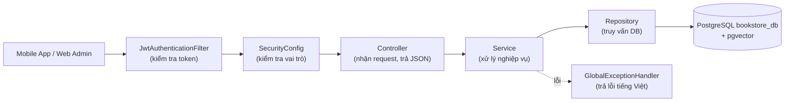

# Giải thích chi tiết từng file trong Backend Spring Boot + Gradle

> [!NOTE]
> Tài liệu này giải thích cấu trúc **đề xuất**. Thư mục `backend/` trong project hiện **chưa bị sửa** (vẫn là code Node.js/TypeScript cũ).

## Luồng chạy tổng quát của 1 request

**Quy tắc phân tầng:** Controller chỉ gọi Service → Service gọi Repository → Repository làm việc với Entity. Controller **không** gọi thẳng Repository, Entity **không** trả thẳng ra ngoài (dùng DTO).

---

## 0. File gốc của project (Gradle)

| File | Tác dụng |
| :--- | :--- |
| `build.gradle` | "Danh sách đi chợ" của project: khai báo Java 21, phiên bản Spring Boot và các thư viện (Web, Data JPA, Security, Validation, JWT, driver PostgreSQL, Spring AI, pgvector). Gradle đọc file này để tải thư viện và build. |
| `settings.gradle` | Đặt tên project (`bookstore-backend`). |
| `gradlew` / `gradlew.bat` | Gradle Wrapper: chạy `.\gradlew.bat bootRun` là build + chạy mà **không cần cài Gradle** lên máy (Mac/Linux dùng `gradlew`, Windows dùng `gradlew.bat`). |
| `gradle/wrapper/` | Chứa phiên bản Gradle cố định để mọi thành viên nhóm build giống nhau. |

## 1. `resources/` – Cấu hình

| File | Tác dụng |
| :--- | :--- |
| `application.yml` | Cấu hình chính: chuỗi kết nối `jdbc:postgresql://localhost:5432/bookstore_db`, user/password, `ddl-auto: validate` (Hibernate chỉ **kiểm tra** Entity có khớp bảng không, **không tự xóa/tạo bảng** → giữ nguyên dữ liệu đã nạp), JWT secret + thời hạn token, API key cho Gemini/OpenAI, cổng chạy server. |
| `application-dev.yml` | Cấu hình riêng khi lập trình: bật in câu SQL ra console, log chi tiết, CORS mở cho localhost. Khi deploy thật dùng profile khác, không ảnh hưởng. |

## 2. `BookstoreApplication.java`

File có hàm `main` và `@SpringBootApplication` – điểm khởi động toàn bộ ứng dụng. Spring quét tất cả package bên dưới `com.trithucviet.bookstore` để tự tạo các Bean (Controller, Service, Repository...).

## 3. `config/` – Cấu hình hệ thống & bảo mật

| File | Tác dụng |
| :--- | :--- |
| `CorsConfig.java` | Cho phép trình duyệt/app ở **origin khác** gọi API. Không có file này, Web Admin (`localhost:5173`) và Mobile web (`localhost:8081`) sẽ bị trình duyệt chặn lỗi CORS. |
| `SecurityConfig.java` | "Bảo vệ cổng": quy định đường dẫn nào ai được vào. VD: `/api/v1/auth/**`, `/api/v1/books/**` → ai cũng vào; `/api/v1/cart/**` → phải đăng nhập; `/api/admin/**` → chỉ `ADMIN`, `WAREHOUSE_MANAGER`, `CSKH`. Bật `@EnableMethodSecurity` để phân quyền chi tiết bằng `@PreAuthorize` trên từng hàm. Cấu hình mã hóa mật khẩu (BCrypt), tắt session (dùng JWT stateless). |
| `JwtTokenProvider.java` | Tạo token khi đăng nhập thành công (nhúng `userId`, `vai_tro`, thời hạn) và giải mã/kiểm tra token còn hợp lệ, có bị sửa hay hết hạn không. |
| `JwtAuthenticationFilter.java` | Chạy **trước mọi request**: lấy header `Authorization: Bearer <token>` → nhờ `JwtTokenProvider` kiểm tra → nếu hợp lệ thì gắn thông tin người dùng vào `SecurityContext` để các tầng sau biết "ai đang gọi". |
| `AiConfig.java` | Tạo `ChatClient` (model chat) và `EmbeddingModel` (model chuyển văn bản → vector 768 chiều), khai báo **System Prompt** cho tư vấn viên (VD: "Chỉ tư vấn sách có trong cửa hàng, luôn hỏi xác nhận trước khi đặt hàng, trả lời tiếng Việt"). |

## 4. `entity/` – Ánh xạ 17 bảng CSDL

Mỗi class = 1 bảng trong `bookstore_db`, mỗi thuộc tính = 1 cột. Dùng `@Table(name = "...")`, `@Column(name = "...")` để khớp đúng tên tiếng Việt không dấu. Các quan hệ khóa ngoại thể hiện bằng `@ManyToOne` / `@OneToMany`.

| File | Bảng | Tác dụng |
| :--- | :--- | :--- |
| `enums/` | – | Các giá trị cố định thay cho chuỗi gõ tay: `VaiTro`, `TrangThaiDon` (`PENDING`, `PREPARING`, `SHIPPING`, `DELIVERED`, `CANCELLED`), `TrangThaiThanhToan`, `PhuongThucThanhToan`, `LoaiGiam` (`FIXED`, `PERCENTAGE`), `LoaiThongBao`, `TrangThaiDoiTra`. Tránh lỗi gõ sai chính tả trạng thái. |
| `TkNguoiDung.java` | `tk_nguoi_dung` | Tài khoản khách hàng & nhân viên, mật khẩu đã mã hóa, vai trò, trạng thái khóa, tổng chi tiêu. |
| `SoDiaChi.java` | `so_dia_chi` | Các địa chỉ nhận hàng của khách, đánh dấu địa chỉ mặc định. |
| `DanhMuc.java` | `danh_muc` | Danh mục sách, tự tham chiếu `danh_muc_cha_id` để tạo cây cha–con. |
| `TacGia.java` | `tac_gia` | Thông tin tác giả. |
| `NhaXuatBan.java` | `nha_xuat_ban` | Thông tin nhà xuất bản. |
| `Sach.java` | `sach` | Trung tâm hệ thống: giá bán, giá gốc, Flash Sale, tồn kho, đã bán, điểm đánh giá, ảnh bìa, mô tả và cột `vector_ngu_nghia` (`vector(768)`) phục vụ tìm kiếm theo ý nghĩa. |
| `SachYeuThich.java` | `sach_yeu_thich` | Sách khách bấm "tim". Khóa chính ghép (`nguoi_dung_id`, `sach_id`). |
| `GioHang.java` | `gio_hang` | Sách trong giỏ, số lượng, đã tick chọn để thanh toán chưa. Khóa chính ghép. |
| `PhieuNhapKho.java` | `phieu_nhap_kho` | Phiếu nhập: mã phiếu, nhà cung cấp, người tạo, tổng số lượng, tổng tiền. |
| `ChiTietPhieuNhap.java` | `chi_tiet_phieu_nhap` | Từng dòng sách trong phiếu nhập (số lượng, giá nhập). |
| `MaGiamGia.java` | `ma_giam_gia` | Voucher: loại giảm, giá trị, giảm tối đa, đơn tối thiểu, giới hạn lượt, ngày hiệu lực. |
| `DonHang.java` | `don_hang` | Đơn hàng: khách, địa chỉ giao, tạm tính, phí ship, tiền giảm, tổng tiền, phương thức & trạng thái thanh toán, trạng thái đơn. |
| `ChiTietDonHang.java` | `chi_tiet_don_hang` | Từng cuốn trong đơn, **lưu lại tên/ảnh/giá tại thời điểm mua** để sau này sách đổi giá cũng không làm sai đơn cũ. |
| `LichSuDonHang.java` | `lich_su_don_hang` | Mốc thời gian chuyển trạng thái đơn (hiển thị timeline "Đã đặt → Đóng gói → Đang giao → Đã giao"). |
| `DanhGia.java` | `danh_gia` | Đánh giá 1–5 sao, bình luận, ảnh, cờ ẩn (khi CSKH/Admin ẩn bình luận vi phạm). |
| `YeuCauDoiTra.java` | `yeu_cau_doi_tra` | Yêu cầu đổi trả (1 đơn chỉ có 1 yêu cầu), lý do, ảnh minh chứng, trạng thái duyệt. |
| `ThongBao.java` | `thong_bao` | Thông báo gửi cho 1 khách (`nguoi_dung_id`) hoặc toàn bộ khách (`nguoi_dung_id = NULL`). |

> [!IMPORTANT]
> Chưa tạo `CauHinhCuaHang.java` vì bảng `cau_hinh_cua_hang` đang được tạm ẩn. Nếu tạo Entity cho bảng không tồn tại, với `ddl-auto: validate` ứng dụng sẽ **không khởi động được**.

## 5. `repository/` – Giao tiếp Database

Là các `interface` kế thừa `JpaRepository`. Spring tự sinh code cho các thao tác cơ bản (`findById`, `save`, `delete`, phân trang) – không cần viết SQL. Chỉ viết thêm hàm cho truy vấn đặc thù.

| File | Tác dụng |
| :--- | :--- |
| `SachRepository.java` | Tìm sách theo tên/tác giả, lọc theo danh mục, khoảng giá, sách sắp hết hàng (`ton_kho <= 5`), sách bán chạy, Flash Sale. Chứa câu **native query pgvector** dùng toán tử `<=>` (khoảng cách cosine) để lấy Top N sách gần nghĩa nhất với câu hỏi của khách. |
| `DonHangRepository.java` | Lọc đơn theo trạng thái/khách/khoảng ngày, tính tổng doanh thu, đếm đơn theo trạng thái cho Dashboard. |
| `TkNguoiDungRepository.java` | Tìm tài khoản theo email (dùng khi đăng nhập), lọc theo vai trò, kiểm tra email đã tồn tại khi đăng ký. |
| `GioHangRepository.java` | Lấy giỏ của 1 khách, lấy các dòng đã tick chọn, xóa các dòng sau khi đặt hàng. |
| `MaGiamGiaRepository.java` | Tìm voucher theo mã, lấy các voucher còn hiệu lực. |
| `...` | Mỗi Entity còn lại có 1 Repository tương ứng (`SoDiaChiRepository`, `DanhMucRepository`, `PhieuNhapKhoRepository`, `DanhGiaRepository`...). |

## 6. `dto/` – Dữ liệu truyền nhận

**Lý do cần DTO:** không trả Entity trực tiếp (tránh lộ `mat_khau_ma_hoa`, tránh vòng lặp JSON vô hạn do quan hệ 2 chiều, tránh lộ cột `vector_ngu_nghia` 768 số). Tên trường DTO khớp với `shared/types` của Frontend để Mobile/Admin dùng lại được.

| Thư mục / File | Tác dụng |
| :--- | :--- |
| `request/` | Dữ liệu **client gửi lên**, kèm kiểm tra hợp lệ (`@NotBlank`, `@Email`, `@Min`...). VD: `LoginRequest` (email, mật khẩu), `CartItemRequest` (sách, số lượng), `CreateOrderRequest` (địa chỉ, phương thức thanh toán, mã giảm giá), `BookUpsertRequest` (thêm/sửa sách), `ChatRequest` (câu hỏi của khách). |
| `response/` | Dữ liệu **server trả về**. `ApiResponse<T>` là khuôn chung `{ success, message, data }` để Frontend xử lý đồng nhất. Các DTO khác: `AuthResponse` (token + thông tin user), `BookDto`, `OrderDto`, `DashboardStatsDto`, `ChatResponse` (câu trả lời + danh sách sách gợi ý để vẽ thẻ sách). |

## 7. `service/` – Logic nghiệp vụ

Nơi chứa **toàn bộ quy tắc của cửa hàng**. Những thao tác sửa nhiều bảng cùng lúc dùng `@Transactional`: nếu 1 bước lỗi thì **hủy toàn bộ**, không để dữ liệu nửa vời (VD: đã tạo đơn nhưng chưa trừ kho).

| File | Tác dụng |
| :--- | :--- |
| `AuthService.java` | Đăng ký, đăng nhập (so khớp mật khẩu BCrypt, sinh JWT), chặn tài khoản bị khóa, chặn `CUSTOMER` đăng nhập vào Web Admin. |
| `BookService.java` | Lấy danh sách/chi tiết sách cho Mobile; thêm/sửa/ẩn sách, danh mục, tác giả, NXB cho Admin; chặn xóa sách đã nằm trong đơn hàng (chỉ cho ẩn). |
| `CartWishlistService.java` | Thêm/sửa/xóa sách trong giỏ (kiểm tra không vượt tồn kho), thêm/bỏ sách yêu thích. |
| `OrderService.java` | **Quan trọng nhất.** Đặt hàng: kiểm tra tồn kho → tính tạm tính, phí ship, giảm giá → tạo `don_hang` + `chi_tiet_don_hang` + `lich_su_don_hang` → trừ `ton_kho`, tăng `da_ban` → tăng `da_su_dung` của voucher → xóa giỏ. Hủy đơn: hoàn lại tồn kho. Chuyển trạng thái đơn theo đúng thứ tự. |
| `InventoryService.java` | Tạo phiếu nhập kho: lưu `phieu_nhap_kho` + `chi_tiet_phieu_nhap` và cộng dồn `ton_kho` cho từng sách trong cùng 1 transaction. |
| `ReviewReturnService.java` | Chỉ cho đánh giá khi đơn đã giao; cập nhật lại `diem_danh_gia_tb`, `so_luot_danh_gia` của sách; tạo & duyệt/từ chối yêu cầu đổi trả. |
| `VoucherService.java` | Kiểm tra mã có hợp lệ không (còn hạn, còn lượt, đủ đơn tối thiểu) và tính số tiền được giảm; CRUD voucher cho Admin. |
| `UserAddressService.java` | Quản lý sổ địa chỉ (đảm bảo chỉ 1 địa chỉ mặc định), xem/khóa tài khoản khách, tạo/phân quyền nhân viên. |
| `NotificationService.java` | Tạo thông báo (tự động khi đơn đổi trạng thái hoặc Admin/CSKH gửi thủ công), đánh dấu đã đọc. |
| `ReportService.java` | Tính số liệu Dashboard (doanh thu, số đơn, sách bán chạy, sách sắp hết), dữ liệu biểu đồ, xuất file CSV. |

## 8. `ai/` – Module tư vấn viên & Vector

| File | Tác dụng |
| :--- | :--- |
| `BookVectorService.java` | Với mỗi cuốn sách, ghép `Tên sách + Tác giả + Danh mục + NXB + Tóm tắt + Từ khóa` thành 1 đoạn văn → gọi `EmbeddingModel` → lưu 768 con số vào `sach.vector_ngu_nghia`. Có hàm đồng bộ toàn bộ 186 cuốn và hàm cập nhật lại khi Admin sửa sách. Cũng dùng để chuyển câu hỏi của khách thành vector khi tìm kiếm. |
| `BookstoreAiTools.java` | Các "công cụ" mà model được phép gọi (Function Calling): tìm sách theo ý nghĩa, xem chi tiết/tồn kho, xem voucher đang chạy, lấy địa chỉ mặc định, thêm vào giỏ, tạo đơn. Các tool này **chỉ gọi lại Service** (`BookService`, `CartWishlistService`, `OrderService`...), nên mọi quy tắc nghiệp vụ (trừ kho, kiểm tra voucher) vẫn được áp dụng y như khi khách tự đặt. Model không bao giờ được viết SQL trực tiếp. |
| `AdvisorChatService.java` | Nhận câu hỏi của khách → gửi kèm System Prompt + danh sách tool cho model → model quyết định gọi tool nào → gom kết quả thành câu trả lời tiếng Việt + danh sách sách gợi ý (`ChatResponse`). Đảm bảo bước **xác nhận lại với khách trước khi tạo đơn**. |

## 9. `controller/` – Cổng REST API

Controller chỉ làm 3 việc: nhận request → gọi Service → trả `ApiResponse`. Không chứa logic nghiệp vụ.

### 9.1. `client/` – Dành cho Mobile App (`/api/v1/**`)

| File | Tác dụng |
| :--- | :--- |
| `ClientAuthController.java` | Đăng ký, đăng nhập, xem/sửa hồ sơ cá nhân. |
| `ClientBookController.java` | Trang chủ, danh sách sách (lọc/tìm/phân trang), chi tiết sách, danh mục. Không cần đăng nhập. |
| `ClientCartController.java` | Xem giỏ, thêm, đổi số lượng, tick chọn, xóa. |
| `ClientWishlistController.java` | Xem danh sách yêu thích, thêm/bỏ yêu thích. |
| `ClientAddressController.java` | Xem/thêm/sửa/xóa địa chỉ, đặt địa chỉ mặc định. |
| `ClientVoucherController.java` | Xem voucher đang có, kiểm tra mã trước khi thanh toán. |
| `ClientOrderController.java` | Đặt hàng, xem lịch sử đơn, chi tiết + timeline đơn, hủy đơn khi còn `PENDING`. |
| `ClientReviewReturnController.java` | Gửi đánh giá cho đơn đã giao, gửi yêu cầu đổi trả. |
| `ClientNotificationController.java` | Xem danh sách thông báo, đánh dấu đã đọc. |
| `ClientChatController.java` | `POST /api/v1/chat/ask` – cổng của hộp thoại tư vấn, gọi `AdvisorChatService`. |

### 9.2. `admin/` – Dành cho Web Admin (`/api/admin/**`)

Mỗi hàm gắn `@PreAuthorize` theo đúng [PHAN_QUYEN_WEB_ADMIN.md](file:///e:/LapTrinhMobile/demo_Ck/BaiTapLon/BookStore_Antigravity/PHAN_QUYEN_WEB_ADMIN.md).

| File | Tác dụng | Ai được dùng |
| :--- | :--- | :--- |
| `AdminDashboardController.java` | Số liệu tổng quan, biểu đồ, xuất CSV. | `ADMIN` xem tất cả; `WAREHOUSE_MANAGER` chỉ chỉ số kho; `CSKH` chỉ chỉ số đơn/đổi trả |
| `AdminBookCategoryController.java` | CRUD sách, danh mục, tác giả, NXB; chỉnh giá/Flash Sale; nút đồng bộ lại vector. | `ADMIN` toàn quyền; `WAREHOUSE_MANAGER` thêm/sửa thông tin (không sửa giá, không xóa); `CSKH` chỉ xem |
| `AdminInventoryController.java` | Tạo/xem phiếu nhập kho, danh sách sách sắp hết. | `ADMIN`, `WAREHOUSE_MANAGER` |
| `AdminOrderReturnController.java` | Xem/lọc đơn, chuyển trạng thái, duyệt đổi trả. | `ADMIN` toàn quyền; `WAREHOUSE_MANAGER` chuyển `PENDING → PREPARING → SHIPPING`; `CSKH` xác nhận/hủy đơn & duyệt đổi trả |
| `AdminVoucherController.java` | CRUD, bật/tắt voucher. | `ADMIN` toàn quyền; `CSKH` chỉ xem |
| `AdminUserController.java` | Danh sách khách, khóa/mở tài khoản; tạo & phân quyền nhân viên. | `ADMIN` toàn quyền; `CSKH` chỉ xem khách |
| `AdminReviewNotifController.java` | Ẩn/hiện đánh giá, gửi thông báo. | `ADMIN`, `CSKH` |

## 10. `exception/` – Bắt lỗi tập trung

| File | Tác dụng |
| :--- | :--- |
| `BusinessException.java` | Lỗi nghiệp vụ do mình chủ động ném ra kèm thông báo tiếng Việt, VD: `"Sách 'Hamlet' chỉ còn 2 cuốn trong kho"`, `"Đơn hàng chưa đủ 300.000đ để dùng mã này"`. |
| `GlobalExceptionHandler.java` | Dùng `@RestControllerAdvice` bắt **mọi lỗi** ở một chỗ và chuyển thành `ApiResponse` thống nhất với mã HTTP phù hợp: lỗi nghiệp vụ → `400`, sai dữ liệu nhập (`@Valid`) → `400` kèm danh sách trường sai, chưa đăng nhập → `401`, không đủ quyền → `403`, không tìm thấy → `404`, lỗi bất ngờ → `500` (không lộ stack trace). Nhờ vậy Mobile & Web chỉ cần đọc `message` để hiển thị. |

## 11. `test/`

| File | Tác dụng |
| :--- | :--- |
| `BookstoreApplicationTests.java` | Kiểm tra ứng dụng khởi động được và mọi Entity khớp với 17 bảng trong `bookstore_db`. Có thể bổ sung test cho `OrderService` (trừ kho, áp voucher) vì đây là phần dễ sai nhất. |
