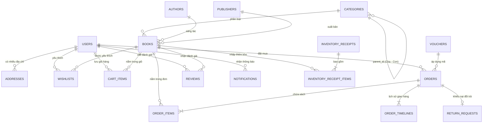
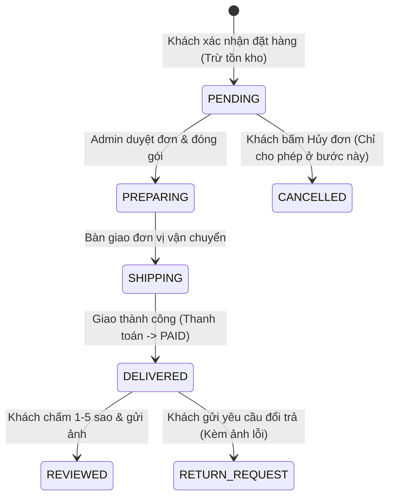
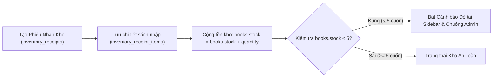

# TÀI LIỆU PHÂN TÍCH NGHIỆP VỤ & THIẾT KẾ CƠ SỞ DỮ LIỆU

> [!IMPORTANT]
> Tài liệu này tổng hợp toàn bộ **18 bảng cơ sở dữ liệu**, **Sơ đồ Quan hệ Thực thể (ERD)**, **Sơ đồ Vòng đời Đơn hàng** và **Các quy tắc ràng buộc nghiệp vụ** được trích xuất trực tiếp từ 2 giao diện **Client Mobile App** và **Admin Web Dashboard**.

---

## 1. Sơ đồ Quan hệ Thực thể Tổng thể (ERD)

---

## 2. Sơ đồ Luồng Nghiệp vụ Đơn hàng & Hậu mãi

---

## 3. Tổng quan Danh sách 18 Bảng CSDL

| STT | Tên Bảng (Table) | Tên Tiếng Việt | Phân hệ sử dụng | Khóa ngoại (Foreign Keys) |
| :-: | :--- | :--- | :--- | :--- |
| 01 | `users` | Người dùng & Nhân sự | Mobile & Web Admin | *(Bảng gốc)* |
| 02 | `addresses` | Sổ địa chỉ nhận hàng | Mobile (Hồ sơ & Checkout) | `user_id` → `users.id` |
| 03 | `categories` | Danh mục sách (Cha/Con) | Mobile & Web Admin | `parent_id` → `categories.id` |
| 04 | `authors` | Tác giả | Mobile & Web Admin | *(Bảng gốc)* |
| 05 | `publishers` | Nhà xuất bản | Mobile & Web Admin | *(Bảng gốc)* |
| 06 | `books` | Thông tin Sách | Mobile & Web Admin | `category_id`, `author_id`, `publisher_id` |
| 07 | `wishlists` | Tủ sách yêu thích | Mobile (Tài khoản) | `user_id` → `users.id`, `book_id` → `books.id` |
| 08 | `inventory_receipts` | Phiếu nhập kho | Web Admin (Quản lý Kho) | *(Bảng gốc)* |
| 09 | `inventory_receipt_items` | Chi tiết phiếu nhập | Web Admin (Quản lý Kho) | `receipt_id`, `book_id` |
| 10 | `cart_items` | Giỏ hàng | Mobile (Giỏ hàng) | `user_id` → `users.id`, `book_id` → `books.id` |
| 11 | `vouchers` | Mã giảm giá | Mobile & Web Admin | *(Bảng gốc)* |
| 12 | `orders` | Đơn đặt hàng | Mobile & Web Admin | `user_id` → `users.id` |
| 13 | `order_items` | Chi tiết sách trong đơn | Mobile & Web Admin | `order_id` → `orders.id`, `book_id` → `books.id` |
| 14 | `order_timelines` | Lịch sử hành trình giao | Mobile & Web Admin | `order_id` → `orders.id` |
| 15 | `return_requests` | Yêu cầu đổi trả hàng | Mobile & Web Admin | `order_id` → `orders.id` *(Quan hệ 1-1)* |
| 16 | `reviews` | Đánh giá & Nhận xét | Mobile & Web Admin | `book_id`, `user_id`, `order_id` |
| 17 | `notifications` | Thông báo đẩy | Mobile & Web Admin | `user_id` → `users.id` *(Nullable)* |
| 18 | `store_configs` | Cấu hình cửa hàng | Web Admin (Cấu hình) | *(Bảng 1 dòng duy nhất)* |

---

## 4. Chi tiết Thiết kế Bảng & Quy tắc từng Phân hệ

### Phân hệ 1: Tài khoản, Phân quyền (RBAC) & Sổ địa chỉ

#### 1. Bảng `users` (Người dùng & Nhân sự)
| Tên cột | Kiểu dữ liệu | Ràng buộc | Mô tả |
| :--- | :--- | :--- | :--- |
| `id` | `VARCHAR(50)` | `PRIMARY KEY` | Mã người dùng |
| `full_name` | `NVARCHAR(100)` | `NOT NULL` | Họ và tên |
| `email` | `VARCHAR(120)` | `UNIQUE, NOT NULL` | Email đăng nhập |
| `password_hash` | `VARCHAR(255)` | `NOT NULL` | Mật khẩu đã mã hóa |
| `phone` | `VARCHAR(20)` | `NOT NULL` | Số điện thoại |
| `role` | `VARCHAR(30)` | `DEFAULT 'CUSTOMER'` | `'CUSTOMER'`, `'ADMIN'`, `'WAREHOUSE_MANAGER'`, `'CSKH'` |
| `is_locked` | `BIT` | `DEFAULT 0` | `0`: Hoạt động, `1`: Đang bị khóa |
| `total_spent` | `DECIMAL(15,0)` | `DEFAULT 0` | Tổng chi tiêu tích lũy (VND) |
| `order_count` | `INT` | `DEFAULT 0` | Tổng số đơn đã mua |
| `created_at` | `DATETIME` | `DEFAULT NOW()` | Ngày tạo tài khoản |

#### 2. Bảng `addresses` (Sổ địa chỉ nhận hàng)
| Tên cột | Kiểu dữ liệu | Ràng buộc | Mô tả |
| :--- | :--- | :--- | :--- |
| `id` | `VARCHAR(50)` | `PRIMARY KEY` | Mã địa chỉ |
| `user_id` | `VARCHAR(50)` | `FK (users.id)` | Chủ sở hữu địa chỉ |
| `full_name` | `NVARCHAR(100)` | `NOT NULL` | Họ tên người nhận |
| `phone` | `VARCHAR(20)` | `NOT NULL` | SĐT người nhận |
| `province` | `NVARCHAR(100)` | `NOT NULL` | Tỉnh / Thành phố |
| `district` | `NVARCHAR(100)` | `NOT NULL` | Quận / Huyện |
| `ward` | `NVARCHAR(100)` | `NOT NULL` | Phường / Xã |
| `street_address` | `NVARCHAR(255)` | `NOT NULL` | Số nhà, tên đường, tòa nhà |
| `is_default` | `BIT` | `DEFAULT 0` | `1`: Địa chỉ mặc định |

> [!NOTE]
> **Quy tắc nghiệp vụ Phân hệ 1:**
> - **Chặn đăng nhập chéo nền tảng:** Mobile App chỉ cho phép `role = 'CUSTOMER'`. Nếu đăng nhập bằng tài khoản `role != 'CUSTOMER'`, hệ thống chặn và báo: *"Tài khoản quản trị viên vui lòng đăng nhập trên hệ thống Web Dashboard máy tính"*.
> - **Địa chỉ mặc định:** Mỗi khách hàng chỉ có tối đa 1 địa chỉ `is_default = 1`. Khi đặt địa chỉ mới làm mặc định, các địa chỉ cũ của khách đó tự động cập nhật `is_default = 0`.

---

### Phân hệ 2: Danh mục Phân cấp, Tác giả, NXB & Kho Sách

#### 1. Bảng `categories` (Danh mục Cha - Con)
| Tên cột | Kiểu dữ liệu | Ràng buộc | Mô tả |
| :--- | :--- | :--- | :--- |
| `id` | `VARCHAR(50)` | `PRIMARY KEY` | Mã danh mục |
| `name` | `NVARCHAR(120)` | `NOT NULL` | Tên danh mục |
| `slug` | `VARCHAR(150)` | `UNIQUE` | Đường dẫn tĩnh |
| `parent_id` | `VARCHAR(50)` | `FK (categories.id), NULL` | `NULL`: Danh mục Cha; Có giá trị: Danh mục Con |
| `description` | `NVARCHAR(500)` | `NULL` | Mô tả chuyên mục |
| `display_order` | `INT` | `DEFAULT 1` | Thứ tự hiển thị |
| `is_active` | `BIT` | `DEFAULT 1` | Trạng thái hoạt động |

#### 2. Bảng `books` (Thông tin Sách)
| Tên cột | Kiểu dữ liệu | Ràng buộc | Mô tả |
| :--- | :--- | :--- | :--- |
| `id` | `VARCHAR(50)` | `PRIMARY KEY` | Mã sách |
| `isbn` | `VARCHAR(30)` | `UNIQUE, NOT NULL` | Mã ISBN quốc tế |
| `title` | `NVARCHAR(255)` | `NOT NULL` | Tên cuốn sách |
| `category_id` | `VARCHAR(50)` | `FK (categories.id)` | Danh mục sách |
| `author_id` | `VARCHAR(50)` | `FK (authors.id)` | Tác giả |
| `publisher_id` | `VARCHAR(50)` | `FK (publishers.id)` | Nhà xuất bản |
| `price` | `DECIMAL(12,0)` | `NOT NULL` | Giá bán thường (VND) |
| `original_price` | `DECIMAL(12,0)` | `NOT NULL` | Giá bìa trước khi giảm |
| `is_flash_sale` | `BIT` | `DEFAULT 0` | Đang chạy Flash Sale |
| `flash_sale_price` | `DECIMAL(12,0)` | `NULL` | Giá ưu đãi Flash Sale |
| `stock` | `INT` | `DEFAULT 0, CHECK >= 0` | Số lượng tồn kho thực tế |
| `sold_count` | `INT` | `DEFAULT 0` | Số lượng đã bán |
| `rating_avg` | `DECIMAL(3,2)` | `DEFAULT 5.0` | Điểm đánh giá trung bình (`1.0` - `5.0`) |
| `rating_count` | `INT` | `DEFAULT 0` | Số lượt đánh giá |
| `page_count` | `INT` | `NULL` | Số trang |
| `publish_year` | `INT` | `NULL` | Năm xuất bản |
| `cover_format` | `NVARCHAR(30)` | `NOT NULL` | `'Bìa mềm'` hoặc `'Bìa cứng'` |
| `cover_url` | `VARCHAR(500)` | `NOT NULL` | Ảnh bìa sách |
| `short_summary` | `NVARCHAR(500)` | `NULL` | Tóm tắt ngắn |
| `description` | `NVARCHAR(MAX)` | `NULL` | Giới thiệu chi tiết |
| `is_best_seller` | `BIT` | `DEFAULT 0` | Sách bán chạy |
| `is_visible` | `BIT` | `DEFAULT 1` | `1`: Hiển thị trên App, `0`: Ẩn |

---

### Phân hệ 3: Quản lý Nhập Kho & Cảnh báo Tồn Kho

| Bảng | Các cột chính | Quy tắc bắt buộc |
| :--- | :--- | :--- |
| `inventory_receipts` | `id` (PK), `receipt_code` (Unique), `supplier_name`, `created_by`, `note`, `total_quantity`, `total_cost`, `created_at` | Lưu thông tin chung của chứng từ nhập kho. |
| `inventory_receipt_items` | `id` (PK), `receipt_id` (FK), `book_id` (FK), `quantity`, `import_price` | Khi thêm dòng mới, tự động cộng `quantity` vào `books.stock`. |

---

### Phân hệ 4: Giỏ hàng, Mã giảm giá (Voucher) & Đơn đặt hàng

#### 1. Bảng `vouchers` (Mã khuyến mãi)
| Tên cột | Kiểu dữ liệu | Ràng buộc | Mô tả |
| :--- | :--- | :--- | :--- |
| `id` | `VARCHAR(50)` | `PRIMARY KEY` | Mã định danh voucher |
| `code` | `VARCHAR(30)` | `UNIQUE, NOT NULL` | Mã nhập in hoa (VD: `CHAOHE50K`) |
| `title` | `NVARCHAR(150)` | `NOT NULL` | Tên chương trình |
| `discount_type` | `VARCHAR(20)` | `NOT NULL` | `'FIXED'` (Tiền mặt) hoặc `'PERCENTAGE'` (%) |
| `discount_value` | `DECIMAL(12,0)` | `NOT NULL` | Số tiền giảm hoặc số % giảm |
| `max_discount_amount` | `DECIMAL(12,0)` | `NULL` | Trần giảm tối đa khi giảm theo % |
| `min_order_value` | `DECIMAL(12,0)` | `DEFAULT 0` | Đơn tối thiểu để áp dụng mã |
| `usage_limit` | `INT` | `NOT NULL` | Tổng số lượt cho phép |
| `used_count` | `INT` | `DEFAULT 0` | Số lượt đã dùng |
| `start_date` / `end_date` | `DATE` | `NOT NULL` | Thời hạn hiệu lực |
| `is_active` | `BIT` | `DEFAULT 1` | Trạng thái kích hoạt |

#### 2. Bảng `orders` (Đơn hàng)
| Tên cột | Kiểu dữ liệu | Ràng buộc | Mô tả |
| :--- | :--- | :--- | :--- |
| `id` | `VARCHAR(50)` | `PRIMARY KEY` | Mã định danh đơn |
| `order_code` | `VARCHAR(30)` | `UNIQUE, NOT NULL` | Mã đơn (VD: `BS-261101`) |
| `user_id` | `VARCHAR(50)` | `FK (users.id)` | Khách hàng đặt mua |
| `customer_name` | `NVARCHAR(100)` | `NOT NULL` | Tên người nhận lúc đặt |
| `customer_phone` | `VARCHAR(20)` | `NOT NULL` | SĐT người nhận lúc đặt |
| `shipping_address` | `NVARCHAR(500)` | `NOT NULL` | Địa chỉ giao lúc đặt |
| `subtotal` | `DECIMAL(15,0)` | `NOT NULL` | Tạm tính tiền sách |
| `shipping_fee` | `DECIMAL(12,0)` | `NOT NULL` | Phí ship (`0` hoặc `25000`) |
| `discount_amount` | `DECIMAL(12,0)` | `DEFAULT 0` | Tiền giảm qua Voucher |
| `voucher_code` | `VARCHAR(30)` | `NULL` | Mã voucher đã áp |
| `total_amount` | `DECIMAL(15,0)` | `NOT NULL` | Tổng thanh toán cuối cùng |
| `payment_method` | `VARCHAR(20)` | `NOT NULL` | `'COD'`, `'BANK_QR'`, `'EWALLET'` |
| `payment_status` | `VARCHAR(20)` | `DEFAULT 'UNPAID'` | `'UNPAID'`, `'PAID'`, `'REFUNDED'` |
| `status` | `VARCHAR(20)` | `DEFAULT 'PENDING'` | `'PENDING'`, `'PREPARING'`, `'SHIPPING'`, `'DELIVERED'`, `'CANCELLED'` |
| `is_reviewed` | `BIT` | `DEFAULT 0` | Đã đánh giá sao hay chưa |

---

### Phân hệ 5: Hậu mãi — Đánh giá & Yêu cầu Đổi trả

| Bảng | Các cột chính | Quy tắc nghiệp vụ |
| :--- | :--- | :--- |
| `reviews` | `id` (PK), `book_id` (FK), `user_id` (FK), `order_id` (FK), `rating` (1-5), `comment`, `image_urls`, `is_hidden` (`BIT`), `created_at` | Chỉ cho phép đánh giá khi `orders.status = 'DELIVERED'`. Nếu Admin đánh dấu `is_hidden = 1`, bình luận sẽ bị ẩn trên Mobile App. |
| `return_requests` | `id` (PK), `order_id` (FK Unique), `reason`, `description`, `evidence_images`, `status` (`'PENDING'`, `'APPROVED'`, `'REJECTED'`), `admin_note`, `created_at`, `resolved_at` | Mỗi đơn hàng `DELIVERED` được gửi tối đa 1 yêu cầu đổi trả kèm ảnh minh chứng. Admin xem ảnh và Phê duyệt hoặc Từ chối. |

---

## 5. Công thức Tính toán Chuẩn trong Hệ thống

1. **Tạm tính (`subtotal`):**
   $$\text{subtotal} = \sum \left(\text{Đơn giá hiệu lực} \times \text{Số lượng sách được chọn}\right)$$
2. **Phí vận chuyển (`shipping_fee`):**
   - Nếu $\text{subtotal} \ge 300.000\text{ đ} \implies \text{shipping\_fee} = 0\text{ đ}$ *(Miễn phí vận chuyển)*
   - Nếu $\text{subtotal} < 300.000\text{ đ} \implies \text{shipping\_fee} = 25.000\text{ đ}$
3. **Số tiền giảm giá Voucher (`discount_amount`):**
   - Nếu `discount_type = 'FIXED'`: $\text{discount\_amount} = \text{discount\_value}$
   - Nếu `discount_type = 'PERCENTAGE'`:
     $$\text{discount\_amount} = \min\left(\frac{\text{subtotal} \times \text{discount\_value}}{100},\ \text{max\_discount\_amount}\right)$$
4. **Tổng thanh toán cuối cùng (`total_amount`):**
   $$\text{total\_amount} = \max\left(0,\ \text{subtotal} + \text{shipping\_fee} - \text{discount\_amount}\right)$$
